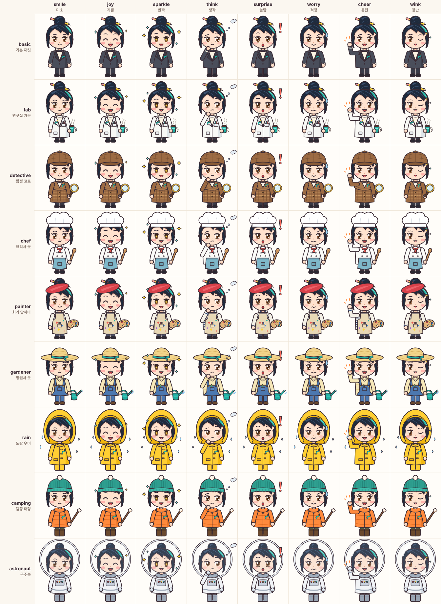

<!-- 이 파일은 tools/readme_gen.py가 data/ 표에서 자동으로 만든다. 손으로 고치지 말 것. -->
# 리아와 파이썬! v0.2

리아 교수와 하루 5~10분, 아이폰 브라우저에서 Python 기초(출력·변수·조건문)를 터치 문제와 직접 코드 작성으로 익히는 듀오링고식 학습 웹앱이에요.

<p align="center"></p>

- 판: **v0.2** (게임 안 버전 표시, `LOG.md`의 판 번호와 같음)
- 내용: 6장 · 레슨 30개 · 문제 231개 · 일일 퀘스트 6종 · 배지 13개 · 리아 교수 의상 9벌 · 표정 8가지
- 서버 없음: Python 실행은 브라우저 안의 **Pyodide**(브라우저에서 돌아가는 Python) `314.0.7`이 맡고, 진도는 휴대폰 안(`localStorage`, 브라우저 저장 칸)에 저장돼요.
- 이 게임은 듀오링고의 학습 방식(연속 기록, 짧은 레슨, 퀘스트)만 참고했고, 듀오링고의 이름·로고·캐릭터는 쓰지 않아요.

## 실행 방법

처음 한 번은 `npm install`로 개발 도구(CodeMirror 입력창, esbuild 묶음 도구, 시험용 Pyodide)를 받아요.

| 하고 싶은 일 | 명령 | 설명 |
|---|---|---|
| 개발하면서 열어 보기 | `python3 tools/dev.py` | 코드를 묶어 `http://127.0.0.1:8765/dev/`로 열어 줘요 |
| 배포 파일 만들기 | `python3 build.py` | `dist/`에 `index.html` 한 장 + `manifest.webmanifest` + `sw.js` + 아이콘. 이 폴더를 그대로 웹에 올리면 돼요 (Pyodide 제외 700KB 이하) |
| README 다시 만들기 | `python3 tools/readme_gen.py` | 데이터 표를 바꾼 뒤 실행. `--check`는 어긋남만 검사 |
| 리아 그림 시트 다시 뽑기 | `python3 tools/ria_sheet.py` | `docs/img/ria-sheet.png`, `ria-hero.png` |

**시험 (확인 도구)**

| 명령 | 확인하는 것 |
|---|---|
| `npm test` | 규칙 단위 시험: 저장·옛 저장 옮기기, 연속 기록 날짜 계산, XP·바이트, 퀘스트·배지·상점, 채점 비교, 대사, 그림 |
| `python3 -m pytest tests/py -q` | 채점기(`runner.py`)를 일반 Python으로 시험: `input()` 값, 오류 줄 번호, 코드 구조 조건 |
| `python3 tests/content.py --full 6` | 레슨 30개 전체 점검: 정답 코드가 시험을 통과하는지, 시작 코드는 통과하지 않는지, 힌트 4개 등 |
| `python3 tests/grader_browser.py` | 실제 브라우저(Chromium) 안 Pyodide 작업자: 실행, 입력, 3초 시간 초과 뒤 재시작 |
| `python3 tests/build_test.py` | 배포 파일: 한 장인지, 크기 상한, 버전 표시, 오프라인 열기 |
| `python3 tests/flow.py` | 아이폰 17 크기 화면 순회: 넘침·콘솔 오류·터치 크기·첫 레슨 끝까지·옛 저장 |
| `node tests/sim/economy.js` | 가상 학습자 30일 × 12판 바이트 경제 시뮬레이션(중앙값 표) |

시험 중 브라우저를 쓰는 것은 Playwright(브라우저를 자동으로 조작하는 도구)의 Chromium이에요. 사파리(WebKit)로는 시험하지 못해서, 실제 아이폰에서 확인할 목록을 `docs/device-checklist.md`에 따로 두었어요.

## 폴더 구조

```
  src/                      화면·규칙 코드, 리아 교수 그림(SVG), 소리, Pyodide 작업자
  src/py/runner.py          학습자 코드를 실행·채점하는 Python 코드(Pyodide 안에서 돎)
  data/lessons/             1~6장 레슨 표 (ch1.js … ch6.js)
  data/                     개념·대사·퀘스트·배지·의상·오류 설명 표
  build.py                  모든 것을 HTML 한 장(dist/index.html)으로 합치기
  tools/                    개발 서버, README 생성, 그림 시트·아이콘 만들기
  tests/                    시험 도구 (unit, py, sim, 브라우저 시험)
  docs/specs/               설계서
  docs/plans/               계획서와 실행 기록(ledger)
  docs/img/                 README용 그림 (스크립트로 뽑음)
  docs/device-checklist.md  실제 아이폰에서 확인할 목록
  README.md LOG.md          설명서(자동 생성)와 개발 일지
```

게임 내용(레슨·퀘스트·배지·의상)은 모두 `data/` 표에 있어요. 표를 고치면 화면 코드는 그대로 두고 내용만 바뀌어요.

## 레슨 30개

한 레슨: 학습 목표 → 개념 카드 1~2장 → 터치 문제(객관식·빈칸·순서) → 직접 작성 1문제 → 이해도 확인 → 틀린 문제 다시 풀기 → 완료 요약. 레슨은 차례로 열려요.

### 1장. 첫 코드

| 레슨 | 제목 | 학습 목표 | 직접 작성 과제 | 핵심 개념 | 문제 |
|---|---|---|---|---|---|
| 1-1 | print로 첫 인사 | print로 화면에 글자를 띄울 수 있다 | 버스 정류장 안내판을 만들어 볼까요? print를 두 번 써서 아래 두 줄을 그대로 출력해 보세요. | print로 출력하기 | 객관식 3 · 빈칸 1 · 순서 1 · 직접 작성 1 · 이해도 확인 1 |
| 1-2 | 문자열 다루기 | 문자열을 이어 붙이고 반복할 수 있다 | 영수증 윗부분을 꾸며 볼까요? 아래 두 줄을 출력해 보세요. 둘째 줄의 = 기호 12개는 * 로 반복해서 만들어 주세요. | 문자열 | 객관식 3 · 빈칸 2 · 순서 1 · 직접 작성 1 · 이해도 확인 1 |
| 1-3 | 숫자 계산 | Python을 계산기처럼 쓸 수 있다 | 편의점에서 1200원짜리 삼각김밥 2개와 1500원짜리 우유 1개를 샀어요. 합계를 직접 쓰지 말고, 곱하기(*)와 더하기(+)를 써서 계산해 출력해 보세요. | 숫자 계산 | 객관식 3 · 빈칸 2 · 순서 1 · 직접 작성 1 · 이해도 확인 1 |
| 1-4 | 주석으로 메모하기 | # 으로 코드에 메모를 남길 수 있다 | 오늘은 맑아서 우산이 필요 없어요. 「우산 챙기기」 줄을 지우지 말고 주석으로 바꿔서, 아래 한 줄만 출력되게 해 보세요. | 주석 | 객관식 3 · 빈칸 1 · 순서 1 · 직접 작성 1 · 이해도 확인 1 |
| 1-5 | 1장 평가 **(장 평가)** | 출력·문자열·계산·주석을 함께 쓸 수 있다 | 새싹 학생의 소개 카드를 만들어 볼까요? 아래 세 줄을 그대로 출력해 보세요. 셋째 줄은 * 로 반복해서 만들어 주세요. | print로 출력하기, 숫자 계산, 주석, 문자열 | 객관식 4 · 빈칸 2 · 순서 1 · 직접 작성 1 · 이해도 확인 1 |

### 2장. 변수와 표현식

| 레슨 | 제목 | 학습 목표 | 직접 작성 과제 | 핵심 개념 | 문제 |
|---|---|---|---|---|---|
| 2-1 | 변수는 이름표 | 값에 이름을 붙여 두고 다시 쓸 수 있다 | 편의점에서 1300원짜리 컵라면을 3개 샀어요. 변수 price에 가격을, 변수 count에 개수를 넣고, 두 변수를 곱한 합계를 출력해 보세요. 3900을 직접 쓰지 말고요. | 변수와 대입, 표현식 | 객관식 4 · 빈칸 1 · 순서 1 · 직접 작성 1 · 이해도 확인 1 |
| 2-2 | 값의 종류, 자료형 | int·float·str을 구별하고 type()으로 확인할 수 있다 | 날씨 앱을 만들어 볼까요? 변수 temp에 오늘 기온 18.5를 넣고, 첫 줄에는 temp의 값을, 둘째 줄에는 type()으로 temp의 자료형을 출력해 보세요. 출력은 「18.5」와 「&lt;class 'float'&gt;」 두 줄이에요. | 자료형, 표현식 | 객관식 4 · 빈칸 1 · 순서 1 · 직접 작성 1 · 이해도 확인 1 |
| 2-3 | input으로 묻고 듣기 | input()으로 사용자의 입력을 받아 쓸 수 있다 | 카페 진동벨 안내를 만들어 볼까요? input()으로 손님 이름을 받아 「이름님, 음료 나왔어요」를 출력해 보세요. 리아를 입력하면 「리아님, 음료 나왔어요」예요. 채점을 위해 input() 괄호는 비워 두세요. | input으로 입력받기 | 객관식 4 · 빈칸 1 · 순서 1 · 직접 작성 1 · 이해도 확인 1 |
| 2-4 | 형 변환 | int()·float()·str()로 값의 종류를 바꿀 수 있다 | 버스비 계산기예요. 한 사람에 1500원일 때, input()으로 사람 수를 받아 「버스비 OO원」을 출력해 보세요. 3을 입력하면 「버스비 4500원」이에요. 채점을 위해 input() 괄호는 비워 두세요. | 형 변환 | 객관식 4 · 빈칸 1 · 순서 1 · 직접 작성 1 · 이해도 확인 1 |
| 2-5 | 2장 평가 **(장 평가)** | 변수·자료형·입력·형 변환을 함께 쓸 수 있다 | 커피값 합계 계산기를 만들어 볼까요? 아메리카노(4000원) 잔 수와 라테(4500원) 잔 수를 차례로 input()으로 받아 「합계 OO원」을 출력해 보세요. 2와 1을 입력하면 「합계 12500원」이에요. input() 괄호는 비워 두세요. | 변수와 대입, 자료형, input으로 입력받기, 형 변환 | 객관식 5 · 빈칸 1 · 순서 1 · 직접 작성 1 · 이해도 확인 1 |

### 3장. 조건문

| 레슨 | 제목 | 학습 목표 | 직접 작성 과제 | 핵심 개념 | 문제 |
|---|---|---|---|---|---|
| 3-1 | if로 갈림길 만들기 | 조건이 참일 때만 코드를 실행할 수 있다 | 교통카드 잔액을 input()으로 받아 int()로 바꿔 주세요(질문 글자 없이). 잔액이 1500보다 작으면 「버스비가 모자라요」를 출력하고, 마지막에는 늘 「확인 끝」을 출력해요. 예: 1000을 입력하면 「버스비가 모자라요」와 「확인 끝」 두 줄 | 비교 연산, if 조건문 | 객관식 4 · 빈칸 1 · 순서 1 · 직접 작성 1 · 이해도 확인 1 |
| 3-2 | else로 나머지 처리 | 조건이 거짓일 때 할 일을 else로 정할 수 있다 | 놀이기구 탑승 안내를 만들어요. 키(cm)를 input()으로 받아 int()로 바꿔 주세요(질문 글자 없이). 120 이상이면 「탑승 가능」, 아니면 「다음에 만나요」를 출력해요. 예: 130을 입력하면 「탑승 가능」 | else로 그 밖의 경우, 비교 연산 | 객관식 3 · 빈칸 2 · 직접 작성 1 · 이해도 확인 1 |
| 3-3 | elif로 여러 갈래 | elif로 세 갈래 이상을 나눌 수 있다 | 미세먼지 안내판을 만들어요. 농도를 input()으로 받아 int()로 바꿔 주세요(질문 글자 없이). 30 이하면 「좋음」, 31~80이면 「보통」, 81 이상이면 「나쁨」을 출력해요. 예: 31을 입력하면 「보통」 | elif로 여러 갈래, 비교 연산 | 객관식 3 · 빈칸 2 · 직접 작성 1 · 이해도 확인 1 |
| 3-4 | and·or로 조건 묶기 | and·or·not으로 여러 조건을 묶을 수 있다 | 편의점 계산대예요. 첫 줄에 금액, 둘째 줄에 회원 여부(Y 또는 N)를 input()으로 받아요(질문 글자 없이). and로 두 조건을 묶어, 회원이면서 10000원 이상이면 amount * 9 // 10, 아니면 금액 그대로 출력해요. 예: 12000과 Y → 10800 | and·or·not 논리 연산, 비교 연산 | 객관식 3 · 빈칸 2 · 순서 1 · 직접 작성 1 · 이해도 확인 1 |
| 3-5 | 3장 평가 **(장 평가)** | if·elif·else와 비교·논리로 경우를 나눌 수 있다 | 리아 마을버스 요금 안내를 만들어요. 나이를 input()으로 받아 int()로 바꿔 주세요(질문 글자 없이). 12세 이하는 「어린이 500원」, 13~18세는 「청소년 900원」, 19세 이상은 「어른 1500원」을 출력해요. 예: 13을 입력하면 「청소년 900원」 | 비교 연산, if 조건문, else로 그 밖의 경우, elif로 여러 갈래, and·or·not 논리 연산 | 객관식 5 · 빈칸 2 · 순서 1 · 직접 작성 1 · 이해도 확인 1 |

### 4장. 함수

| 레슨 | 제목 | 학습 목표 | 직접 작성 과제 | 핵심 개념 | 문제 |
|---|---|---|---|---|---|
| 4-1 | 함수 부르기 | 내장 함수를 불러서 값을 얻을 수 있다 | 세 정수를 input()으로 차례로 받아(괄호는 비워 두세요) 가장 큰 값을 max()로 출력해요. 예: 3, 9, 5를 입력하면 「9」 | 함수 부르기 | 객관식 4 · 빈칸 1 · 직접 작성 1 · 이해도 확인 1 |
| 4-2 | def로 만들기 | def로 함수를 만들고 부를 수 있다 | hello(name) 함수를 만들어요. 부르면 「반가워요, ○○님!」을 출력해요. 괄호 안 name은 값을 받는 칸이에요(다음 레슨에서 자세히). 이름을 input()으로 받아(괄호는 비워 두세요) 함수를 불러요. 예: 민지를 입력하면 「반가워요, 민지님!」 | 함수 만들기 | 객관식 3 · 빈칸 1 · 순서 1 · 직접 작성 1 · 이해도 확인 1 |
| 4-3 | 매개변수 | 값을 받아서 쓰는 함수를 만들 수 있다 | price_with_tax(price) 함수를 만들어요. 가격에 세금 10%를 더해 round()로 정수로 만든 값을 출력해요. 가격을 p에 input()으로 받아 int()로 바꾸고(괄호는 비워 두세요) 함수를 불러요. 매개변수 이름은 price예요. 예: 1000을 입력하면 「1100」 | 매개변수 | 객관식 4 · 빈칸 1 · 직접 작성 1 · 이해도 확인 1 |
| 4-4 | 결과 돌려주기 | 결과를 돌려주는 함수를 만들 수 있다 | bmi(kg, m) 함수를 만들어요. kg / (m * m)을 return해요. kg(몸무게)와 m(키)를 input()으로 받아 float()로 바꾸고(괄호는 비워 두세요) bmi의 반환값을 round(…, 1)로 출력해요. 예: 70, 1.75는 「22.9」 | 반환값 | 객관식 4 · 빈칸 1 · 순서 1 · 직접 작성 1 · 이해도 확인 1 |
| 4-5 | 4장 평가 **(장 평가)** | 함수를 부르고 만들고 돌려받는 법을 평가해요 | 영수증 계산기예요. subtotal(price, qty)는 price * qty를 return, discount(total)는 total이 10000 이상이면 1000을 뺀 값을, 아니면 total을 return해요. 단가와 개수를 input()으로 받아 int()로 바꾸고(괄호는 비워 두세요) 최종 금액을 출력해요. 예: 5000, 2는 「9000」 | 함수 부르기, 함수 만들기, 매개변수, 반환값 | 객관식 5 · 빈칸 1 · 직접 작성 1 · 이해도 확인 1 |

### 5장. 반복문

| 레슨 | 제목 | 학습 목표 | 직접 작성 과제 | 핵심 개념 | 문제 |
|---|---|---|---|---|---|
| 5-1 | while로 반복하기 | 조건이 참인 동안 같은 코드를 되풀이할 수 있다 | 로켓 카운트다운이에요. 정수 n을 input()으로 받아(괄호는 비워 두세요) while로 n부터 1까지 한 줄씩 출력하고, 마지막에 「발사!」를 출력해요. 예: 3을 입력하면 3, 2, 1, 발사! | while 반복 | 객관식 3 · 빈칸 1 · 순서 1 · 직접 작성 1 · 이해도 확인 1 |
| 5-2 | for와 range | 정해진 횟수만큼 for와 range로 반복할 수 있다 | 구구단 한 단을 출력해요. 단을 input()으로 받아 int()로 바꿔 주세요(괄호는 비워 두세요). for와 range로 1부터 9까지 곱셈 줄을 출력해요. 예: 3을 입력하면 첫 줄 「3 x 1 = 3」, 끝 줄 「3 x 9 = 27」 | range로 범위 만들기, for 반복 | 객관식 3 · 빈칸 1 · 순서 1 · 직접 작성 1 · 이해도 확인 1 |
| 5-3 | 합계 모으기 | 반복하며 합계와 개수를 모을 수 있다 | 1부터 n까지의 합을 구해요. n을 input()으로 받아 int()로 바꿔 주세요(괄호는 비워 두세요). for와 range로 total에 차례로 더해 합계를 출력해요. 예: 4를 입력하면 10 | 누적 패턴 | 객관식 3 · 빈칸 2 · 순서 1 · 직접 작성 1 · 이해도 확인 1 |
| 5-4 | 멈추기와 건너뛰기 | break와 continue로 반복을 멈추고 건너뛸 수 있다 | 숫자를 input()으로 계속 받아(괄호는 비워 두세요) total에 더해요. while True로 반복하다가 0이 들어오면 break로 멈추고 합계를 출력해요. 예: 5, 3, 0을 차례로 입력하면 8 | break·continue로 멈추기·건너뛰기 | 객관식 3 · 빈칸 1 · 순서 1 · 직접 작성 1 · 이해도 확인 1 |
| 5-5 | 5장 평가 **(장 평가)** | while·for·range와 누적, break를 쓸 수 있다 | 물 마시기 기록이에요. 첫 줄에 일수 n(1 이상), 다음 n줄에 하루 컵 수를 input()으로 받아요(괄호는 비워 두세요). for와 range로 total에 모아 「평균 」 뒤에 round(total / n, 1), 「최대 」 뒤에 max로 구한 값을 출력해요. 예: 3(일수), 2, 4, 3을 넣으면 「평균 3.0」, 다음 줄 「최대 4」 | while 반복, range로 범위 만들기, 누적 패턴, break·continue로 멈추기·건너뛰기, for 반복 | 객관식 4 · 빈칸 1 · 순서 1 · 직접 작성 1 · 이해도 확인 1 |

### 6장. 문자열 다루기

| 레슨 | 제목 | 학습 목표 | 직접 작성 과제 | 핵심 개념 | 문제 |
|---|---|---|---|---|---|
| 6-1 | 글자 하나 꺼내기 | 인덱스로 문자열의 글자 하나를 꺼낼 수 있다 | 이름의 첫 글자와 마지막 글자를 이어서 출력해요. 이름을 input()으로 받고(괄호는 비워 두세요) 인덱스를 써요. 예: coffee를 입력하면 「ce」 | 인덱스 | 객관식 4 · 빈칸 1 · 직접 작성 1 · 이해도 확인 1 |
| 6-2 | 슬라이싱으로 자르기 | [시작:끝]으로 문자열의 일부를 잘라 낼 수 있다 | 날짜를 input()으로 「YYYY-MM-DD」꼴로 받고(괄호는 비워 두세요) 슬라이싱으로 「월 일」을 출력해요. 예: 2026-10-30을 입력하면 「10월 30일」 | 슬라이싱 | 객관식 3 · 빈칸 2 · 직접 작성 1 · 이해도 확인 1 |
| 6-3 | 문자열 메서드 | 메서드로 문자열을 다듬을 수 있다 | 손님이 공백을 섞어 메뉴를 입력했어요. input()으로 받아(괄호는 비워 두세요) 앞뒤 공백을 지우고 대문자로 출력해요. 예: 「  latte 」를 입력하면 「LATTE」 | 문자열 메서드 | 객관식 4 · 빈칸 1 · 순서 1 · 직접 작성 1 · 이해도 확인 1 |
| 6-4 | in과 글자 반복 | 문자열 안을 살피고 글자를 하나씩 돌 수 있다 | 영어 문장을 input()으로 받고(괄호는 비워 두세요) 소문자 모음(a, e, i, o, u)이 몇 개인지 출력해요. 글자를 하나씩 보며 세요. 예: hello world를 입력하면 「3」 | 문자열 반복, 문자열 메서드 | 객관식 3 · 빈칸 1 · 순서 1 · 직접 작성 1 · 이해도 확인 1 |
| 6-5 | 6장 평가 **(장 평가)** | 문자열 다루기 전체를 한 번에 써 볼 수 있다 | 메모를 input()으로 받고(괄호는 비워 두세요) 공백을 지워 소문자로 바꿔요. 첫 글자는 인덱스로, 나머지는 슬라이싱으로 이어 첫 글자만 대문자로 출력하고, 다음 줄에 단어 수를 for로 세어요. 예: 「  iCE LATTE 」→ 「Ice latte」, 「2」 | 인덱스, 슬라이싱, 문자열 메서드, 문자열 반복 | 객관식 4 · 빈칸 1 · 순서 1 · 직접 작성 1 · 이해도 확인 1 |

## 게임 장치

- **XP**(경험치): 레슨 첫 완료 10 (장 평가 30) + 실수 없음 5 + 힌트 없이 직접 작성 통과 5. 다시 하기는 10 (장 평가 15), 복습 한 판 10.
- **하루 목표와 연속 기록**: 하루 목표 10·20·30 XP(기본 20)를 채운 날마다 +1. 기록 보호권(200바이트, 최대 2개)이 빠진 날을 메워 줘요. 7·30·100일에 축하와 보상.
- **바이트**: 게임 속 돈. 레슨 첫 완료 10 + 실수 없음 5, 퀘스트, 보물상자 10, 연속 7일 50. 의상과 보호권을 사요.

### 일일 퀘스트 (6종 중 매일 3개)

날짜로 정해지는 뽑기라 같은 날에는 언제 열어도 같은 퀘스트가 나와요. 3개를 다 끝내면 보물상자(+10바이트).

| 퀘스트 | 목표 | 보상(바이트) |
|---|---|---|
| 레슨 2개 완료하기 | 2 | 5 |
| XP 20 얻기 | 20 | 5 |
| 힌트 없이 코드 통과하기 | 1 | 8 |
| 오류 난 코드를 고쳐서 통과하기 | 1 | 8 |
| 틀린 문제 3개 복습하기 (복습할 문제가 없는 날은 나오지 않음) | 3 | 5 |
| 실수 없이 레슨 끝내기 | 1 | 8 |

### 배지 13개

얻기 전에는 회색 실루엣과 조건 문구가 보여요.

| 배지 | 얻는 조건 |
|---|---|
| 첫 출력 | 첫 레슨(1-1)을 끝내요 |
| 1장 완료 | 1장 마지막 레슨을 끝내요 |
| 2장 완료 | 2장 마지막 레슨을 끝내요 |
| 3장 완료 | 3장 마지막 레슨을 끝내요 |
| 연속 7일 | 7일 연속으로 하루 목표를 채워요 |
| 연속 30일 | 30일 연속으로 하루 목표를 채워요 |
| 연속 100일 | 100일 연속으로 하루 목표를 채워요 |
| 오류 해결사 | 오류 난 코드를 고쳐서 5번 통과해요 |
| 힌트 없이 10회 | 힌트 없이 코드를 10번 통과해요 |
| 완벽주의자 | 실수 없는 레슨을 10번 끝내요 |
| 복습왕 | 복습 문제를 30개 풀어요 |
| 의상 수집가 | 기본 옷 말고 의상 3벌을 모아요 |
| 밤 공부 | 밤 10시부터 새벽 4시 사이에 레슨을 끝내요 |

### 리아 교수 의상 9벌

| 의상 | 얻는 법 |
|---|---|
| 기본 (터틀넥 + 재킷 + 뱀 브로치) | 처음부터 입고 있음 |
| 연구실 가운 + 커피 | 100바이트 |
| 탐정 (체크 코트 + 돋보기) | 180바이트 · 오류 설명이 탐정 말투로 바뀜 |
| 요리사 | 180바이트 |
| 화가 (베레모 + 팔레트) | 180바이트 |
| 정원사 (밀짚모자 + 물뿌리개) | 180바이트 |
| 비 오는 날 (노란 우비) | 240바이트 |
| 캠핑 (패딩 + 비니) | 240바이트 |
| 우주인 | 30일 연속 기록 보상 (판매 안 함) |

## 리아 교수 (문리아)

컴퓨터공학 박사이자 현업 엔지니어 출신이라는 설정의 **가상 인물**이에요. 짙은 남색 올림머리에 청록 브릿지 한 줄, 뱀 브로치가 특징이고, 「~해요」체로 차분하고 가볍게 장난치는 선배 교수 말투를 써요. 오류는 「단서」라고 불러요.

그림은 이미지 파일 없이 코드(SVG)로 그려서, 의상 9벌 × 표정 8가지(미소 · 기쁨 · 반짝 · 생각 · 놀람 · 걱정 · 응원 · 장난)를 자유롭게 조합해요.

<p align="center"></p>

홈 화면 아이콘:

 

## 출처와 독창성

- **리아 교수**는 이 게임을 위해 새로 만든 캐릭터예요. 실존 인물의 이름·외모·경력을 따오지 않았어요.
- **레슨 문장과 예제**는 모두 새로 썼어요. 아래 두 자료는 **장 순서와 예제 주제를 정하는 참고로만** 썼고, 문장을 옮기지 않았어요.
  - Python Tutorial 3.7 — Python Software Foundation (PSF)
  - Thomas Weise, 『Programming with Python』
- 쓰는 도구: Pyodide (MPL-2.0), CodeMirror 6 (MIT), esbuild (MIT, 빌드 때만). 소리는 Web Audio로 합성해 음원 파일이 없어요.

## 알려진 한계

- 실제 아이폰 사파리에서는 아직 확인하지 못했어요. 시험은 Chromium에 아이폰 17 화면 설정을 입혀서 했어요 → `docs/device-checklist.md`.
- Pyodide는 처음 한 번 인터넷(jsDelivr, 공개 파일 배달망)에서 받아요(`pyodide@314.0.7`). 이 개발 환경에서는 그 주소에 접속해 보지 못했어요.
- 사파리는 홈 화면에 추가하지 않은 웹사이트의 저장을 7일 동안 방문이 없으면 지울 수 있어요. 첫 레슨 뒤 「홈 화면에 추가」를 안내하고, 설정에 저장 내보내기·가져오기를 두었어요.
- 서버가 없어 「숨은 시험」도 페이지 안에 들어 있어요. 진짜로 숨기는 것은 v0.2(서버)에서 해요.
- 코드 구조 검사(`ast`, Python이 코드를 문법 나무로 읽는 기능)로는 `elif`·`else`를 꼭 쓰게 강제할 수 없어요. 1-4(주석) 과제는 줄을 지워도 통과해요.
- 레슨을 하던 중 앱을 닫으면 그 레슨은 처음부터 다시 해요(레슨 중간은 저장하지 않음).
- PC에서도 열리지만 휴대폰 폭 그대로 가운데에 놓여요.
- 리아 교수의 외모와 대사 말투는 사용자 확인을 기다리고 있어요.

개발 과정과 결정 기록은 `LOG.md`, 설계는 `docs/specs/`, 작업 계획과 판정 기록은 `docs/plans/`에 있어요.
