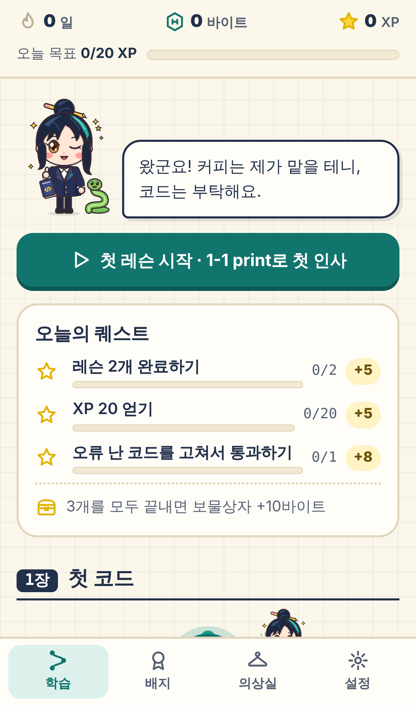
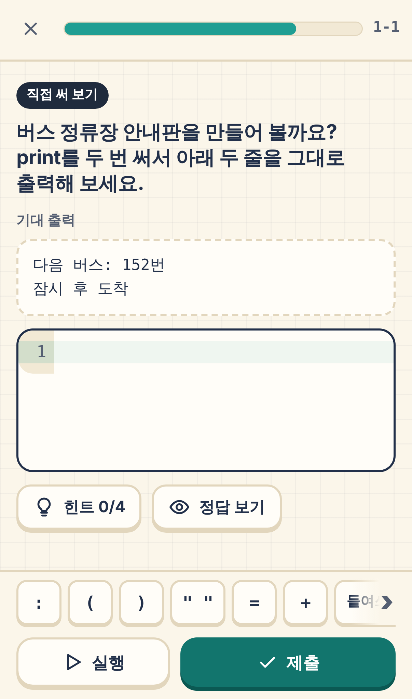
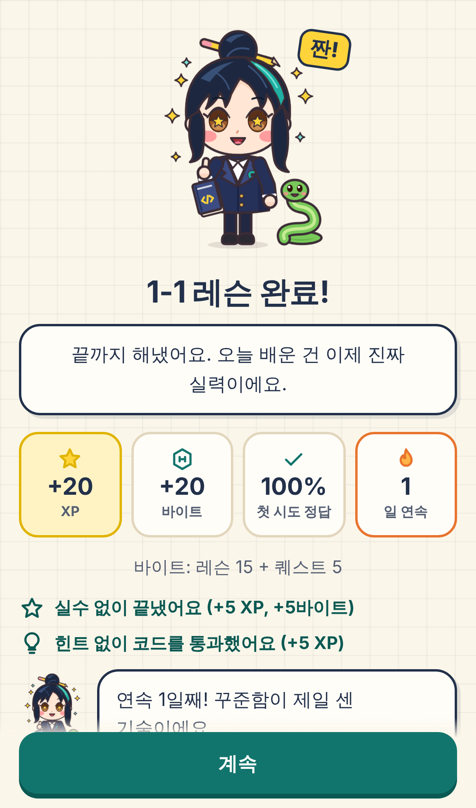
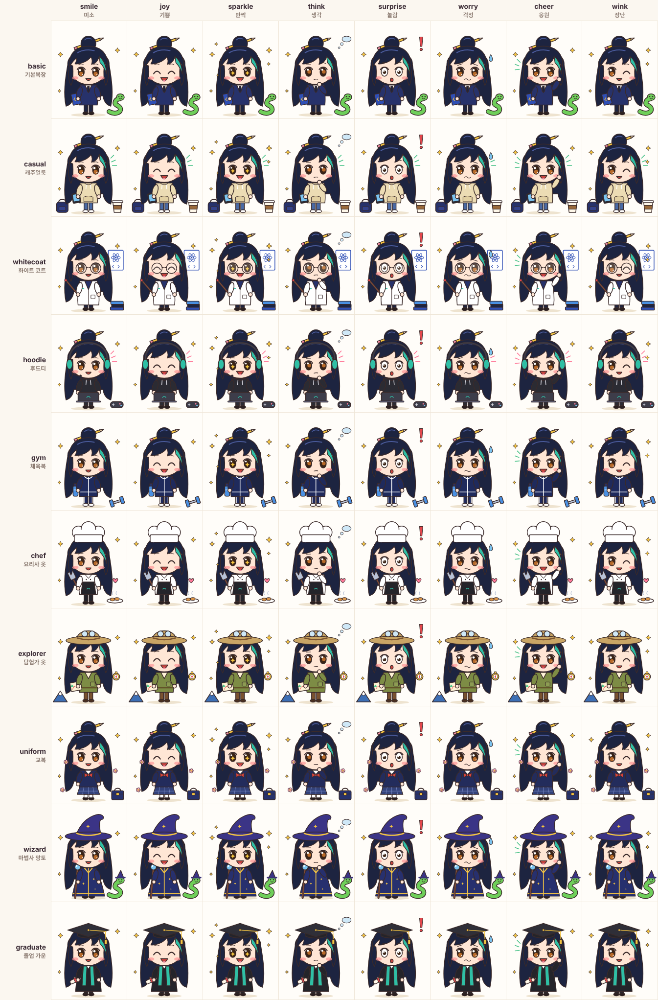

<!-- 이 파일은 tools/readme_gen.py가 data/ 표에서 자동으로 만든다. 손으로 고치지 말 것. -->
# 리아와 파이썬! v0.20.1

리아 교수와 하루 5~10분, 휴대폰 브라우저에서 Python을 첫 코드부터 데이터 시각화까지 터치 문제와 직접 코드 작성으로 익히는 듀오링고식 학습 웹앱이에요. 설치할 것 없이 브라우저 안에서 코드가 실행되고 바로 채점돼요.

**▶ [앱 바로 열기](https://fullcharge13.github.io/Learning-Python/)** — 아이폰은 사파리로 연 뒤 공유 → 「홈 화면에 추가」하면 앱처럼 쓰고 오프라인에서도 돼요.

> 이 저장소는 앱의 **소스 코드**예요. 공부는 위 링크의 앱에서 하고, 아래 「실행 방법」은 앱을 고치거나 다시 만들 때 써요.

> **English** — *Ria & Python!* is a free, Duolingo-style Python course for your phone: 17 chapters from your first `print` to data charts, taught by Professor Ria in 5–10 minute lessons with tap questions and real code you write and run right in the browser (no install, works offline once opened). [Open the app](https://fullcharge13.github.io/Learning-Python/) — it starts in English if your phone is set to English, and you can switch any time under *Settings → Language*. Pi's Garden, the coding mini-game, is in English too.

<p align="center">  </p>

**배우는 것** — 1장 첫 코드 · 2장 변수와 표현식 · 3장 조건문 · 4장 함수 · 5장 반복문 · 6장 문자열 다루기 · 7장 리스트 · 8장 딕셔너리 · 9장 튜플과 집합 · 10장 예외 처리 · 11장 파일 · 12장 정규표현식 · 13장 네트워크 기초 · 14장 웹 API와 JSON · 15장 객체지향 · 16장 데이터베이스와 SQL · 17장 데이터 시각화

- 판: **v0.20.1** (게임 안 버전 표시, `LOG.md`의 판 번호와 같음)
- 내용: 17장 · 레슨 85개 · 심화 레슨 51개 · 문제 1025개 · 일일 퀘스트 7종 · 배지 18개 · 리아 교수 의상 10벌 · 표정 8가지
- 서버 없음: Python 실행은 브라우저 안의 **Pyodide**(브라우저에서 돌아가는 Python) `314.0.7`이 맡고, 진도는 휴대폰 안(`localStorage`, 브라우저 저장 칸)에 저장돼요.
- 언어: 한국어 · English(v0.14.0~). 「한국어 / English」를 직접 고르기 전에는 열 때마다 휴대폰 언어를 따르고(한국어가 아니면 영어), 시작 화면·설정에서 한 번 고르면 그 언어를 지켜요(v0.14.3, 그 전부터 쓰던 저장은 「고른 것」으로 쳐요). 화면 문구, 레슨 17장(본 과정·심화·매일 도전), 텃밭(노드가 만드는 코드·쪽지·주문), 파이썬 실행 안내까지 모두 영어예요. 영어 텃밭은 carrot·up·orders.txt 같은 영어 이름을 쓰고, 저장은 언어와 상관없이 같아요. 영어로 배우면 영어 장 파일을 미리 받아 두어 오프라인에서도 돼요.
- 이 게임은 듀오링고의 학습 방식(연속 기록, 짧은 레슨, 퀘스트)만 참고했고, 듀오링고의 이름·로고·캐릭터는 쓰지 않아요.

## 실행 방법

처음 한 번은 `npm install`로 개발 도구(CodeMirror 입력창, esbuild 묶음 도구, 시험용 Pyodide)를 받아요.

| 하고 싶은 일 | 명령 | 설명 |
|---|---|---|
| 개발하면서 열어 보기 | `python3 tools/dev.py` | 코드를 묶어 `http://127.0.0.1:8765/dev/`로 열어 줘요 |
| 배포 파일 만들기 | `python3 build.py` | `dist/`에 `index.html`(앱과 레슨 목록) + `lessons/`(장마다 문제 파일) + `manifest.webmanifest` + `sw.js` + 아이콘. **`lessons/` 폴더까지 함께** 이 폴더를 그대로 웹에 올리면 돼요(영어판 `lessons/en/`·`lang/` 포함) (Pyodide 제외 600KB 이하) |
| README 다시 만들기 | `python3 tools/readme_gen.py` | 데이터 표를 바꾼 뒤 실행. `--check`는 어긋남만 검사 |
| 리아 그림 데이터 다시 만들기 | `python3 tools/ria_set2_import.py` | 원본 `art/ria_set2_sheet.svg`(#리아_이미지_세트2)를 고친 뒤 실행 → `data/ria_set2.js` |
| 리아 그림 시트 다시 뽑기 | `python3 tools/ria_sheet.py` | `docs/img/ria-sheet.png`, `ria-hero.png` |
| README 첫머리 화면 캡처 바꾸기 | `python3 tests/flow.py` 뒤 `python3 tools/readme_shots.py` | `docs/img/screen-home.png`, `screen-write.png`, `screen-done.png` |

**시험 (확인 도구)**

| 명령 | 확인하는 것 |
|---|---|
| `npm test` | 규칙 단위 시험: 저장·옛 저장 옮기기, 연속 기록 날짜 계산, XP·바이트, 퀘스트·배지·상점, 채점 비교, 대사, 그림 |
| `python3 -m pytest tests/py -q` | 채점기(`runner.py`)를 일반 Python으로 시험: `input()` 값, 오류 줄 번호, 코드 구조 조건 |
| `python3 tests/content.py --full 17` | 레슨 85개 전체 점검: 정답 코드가 시험을 통과하는지, 시작 코드는 통과하지 않는지, 힌트 4개 등 |
| `python3 tests/content.py --lang en --full 17` | 영어 레슨(`data/lessons/en/`)을 같은 방법으로 점검: 영어 코드 실행 결과 = 정답 |
| `python3 tests/lesson_parity.py` | 영어 레슨이 한국어와 모양이 같은지(id·정답·문제 수), 한글이 남지 않았는지, 모든 장이 영어인지 |
| `python3 tests/i18n_coverage.py` | 영어 화면 문구: 감싸지 않은 한글·빠진 영어·남는 영어·값 자리 수 |
| `python3 tests/grader_browser.py` | 실제 브라우저(Chromium) 안 Pyodide 작업자: 실행, 입력, 3초 시간 초과 뒤 재시작 |
| `python3 tests/build_test.py` | 배포 파일: 한 장인지, 크기 상한, 버전 표시, 오프라인 열기 |
| `python3 tests/flow.py` | 아이폰 17 크기 화면 순회: 넘침·콘솔 오류·터치 크기·첫 레슨 끝까지·옛 저장 |
| `node tests/sim/economy.js` | 가상 학습자 30일 × 12판 바이트 경제 시뮬레이션(중앙값 표) |

시험 중 브라우저를 쓰는 것은 Playwright(브라우저를 자동으로 조작하는 도구)의 Chromium이에요. 사파리(WebKit)로는 시험하지 못해서, 실제 아이폰에서 확인할 목록을 `docs/device-checklist.md`에 따로 두었어요.

## 폴더 구조

```
  src/                      화면·규칙 코드, 리아 교수 그림(SVG), 소리, Pyodide 작업자
  src/py/runner.py          학습자 코드를 실행·채점하는 Python 코드(Pyodide 안에서 돎)
  data/lessons/             1~17장 레슨 표 (ch1.js … ch17.js)
  data/                     개념·대사·퀘스트·배지·의상·오류 설명 표
  build.py                  모든 것을 HTML 한 장(dist/index.html)으로 합치기
  tools/                    개발 서버, README 생성, 그림 시트·아이콘 만들기
  art/                      리아 그림 원본: #리아_이미지_세트2 시트(ria_set2_sheet.svg, 앱이 씀), #리아_이미지_세트1 보관본(ria_set1/, 빌드에 안 들어감)
  tests/                    시험 도구 (unit, py, sim, 브라우저 시험)
  docs/specs/               설계서
  docs/plans/               계획서와 실행 기록(ledger)
  docs/img/                 README용 그림 (스크립트로 뽑음)
  docs/device-checklist.md  실제 아이폰에서 확인할 목록
  README.md LOG.md          설명서(자동 생성)와 개발 일지
```

게임 내용(레슨·퀘스트·배지·의상)은 모두 `data/` 표에 있어요. 표를 고치면 화면 코드는 그대로 두고 내용만 바뀌어요.

## 레슨 85개 + 심화 51개

한 레슨: 학습 목표 → 개념 카드 1~2장 → 터치 문제(객관식·빈칸·순서) → 직접 작성 1문제 → 이해도 확인 → 틀린 문제 다시 풀기 → 완료 요약. 레슨은 차례로 열려요.

**심화**(선택): 장 평가를 통과하면 그 장의 심화 레슨 3개가 한꺼번에 열려요. 건너뛰어도 다음 장은 열리고, 과정 완주와 「레슨 N개 중 M개 완료」에는 들어가지 않아요. 학습 길에서는 장 평가 아래 별 노드로 보여요.

**매일 도전**(v0.9): 홈 맨 위 「오늘의 도전」 카드. 하루 3문제 — 문제 틀 83개에서 이름·숫자를 바꿔 만든 터치 2문제와 끝낸 레슨의 직접 작성 1문제(틀린 개념이 든 레슨을 더 자주). 끝낸 장에서만 나오고, 같은 날 다시 열면 같은 문제예요. 다 풀면 XP 15 · 바이트 10, 「도전 n일째」 연속 7일마다 바이트 +20. 비행기 모드에서도 돼요.

## 파이의 텃밭 (v0.10)

1장 평가를 통과하면 「파이의 텃밭」이 열려요. 하단 메뉴 「텃밭」 칸으로 들어가요(v0.12.5, 새 소식이 있으면 빨간 점). 노드를 위에서 아래로 이으면 진짜 파이썬 코드가 함께 만들어지고, 「실행」하면 브라우저 안 파이썬이 그 코드를 돌려 작은 뱀 파이가 텃밭에서 움직여요(익숙해지면 코드로 직접 쓰기). 리아 교수의 주문을 해내면 XP 5, 거둔 작물로 밭을 넓혀요. 한 실행에 행동 500번·살펴보기 2000번까지.

| 장 | 열리는 노드 |
|---|---|
| 1장 | 이동 · 수확 · 심기 · 말하기 |
| 2장 | 값 기억하기 · 값 더하기 |
| 3장 | 만약 |
| 4장 | 내 노드 만들기 · 내 노드 부르기 |
| 5장 | 반복 · ~하는 동안 |
| 6장 | 값 넣어 말하기 |
| 7장 | 목록에서 하나씩 |
| 9장 | 위치 알기 |
| 10장 | 시도하기 |
| 11장 | 쪽지 읽기 · 줄 나누기 · 일지 쓰기 |
| 12장 | 패턴 찾기 |

주문 29개: 첫 수확(1장) · 파이의 인사(1장) · 씨앗 심기(1장) · 급식실 당근(1장) · 수확 세기(2장) · 한 줄 거두기(2장) · 당근 수프(2장) · 다 자랐을 때만(3장) · 첫 감자(3장) · 밭 넓히기(3장) · 내 노드 만들기(4장) · 내 노드로 한 줄(4장) · 반복으로 한 줄(5장) · ~하는 동안(5장) · 밭 전체 수확(5장) · 수확 보고(6장) · 섞어 심기(7장) · 한 바퀴 순찰(7장) · 모자란 것만(8장) · 감자 장부(8장) · 줄 끝에서 내려가기(9장) · 지그재그 수확(9장) · 첫 토마토(10장) · 씨앗이 떨어지면(10장) · 주문서대로(11장) · 농장일지(11장) · 어제 일지 읽기(11장) · 손글씨 주문(12장) · 숫자만 뽑기(12장)

성장: 밭 4×4(당근 20) · 밭 5×5(당근 40, 감자 15) · 감자 씨앗(당근 10) · 비료(감자 20)

## 경비실 (v0.15~)

텃밭 화면 안의 「경비실」(사이버 보안 배우기). 가상의 해커 크로우가 공격해 오면, 배운 파이썬으로 경비 코드를 짜서 막아요. 빈칸 채우기로 풀거나 코드로 직접 쓸 수 있고, 「실행」하면 크로우의 시도가 하나씩 다시 재생돼요(🛡 막음 / ✅ 들임 / ❌ 뚫림). 처음 해결하면 XP 5. 방어하는 쪽의 글만 있고, 사람·기관은 모두 가상이에요.

기본 사건 45개(3~17장, 장마다 3개). 그 장을 끝내면 그 장의 기본 사건이 열려요. 사건 본문은 장마다 따로 파일(`guard/chN-지문.json`)로 두고 처음 열 때 받아요(첫 파일에는 목록용 색인만).

여기에 「응용 사건」 15개가 더 있어요(장마다 1개). 그 장의 기본 사건 3개를 모두 해결하면 열리고, 풀면 실제 공격 이름·현실 모습·내가 할 일·검색어가 담긴 「사건 파일」 카드가 열려요. 응용 사건은 보안 등급과 「n/45 해결」에 세지 않아요.

| 장 | 사건 | 제목 | 개념 | 꼬리표 |
|---|---|---|---|---|
| 3장 | G1 | 창고 문 암호 | 인증: 확인된 사람만 들이기 | 대응 |
| 3장 | G2 | 한밤중의 손님 | 접근 통제: 정해진 때만 들이기 | 대응 |
| 3장 | G7 | 창고 열쇠는 누구에게? | 인가: 확인된 사람 중에서도 권한이 있는 사람만 | 대응 |
| 3장 | G46 | 새벽의 승인 알림 | MFA 피로 공격: G1처럼 암호를 확인하는 게 아니라(암호는 이미 털렸어요), 내가 로그인을 시작했는지로 판단해요 | 응용 · 대응 |
| 4장 | G3 | 뻔한 비밀번호 거르기 | 추측하기 쉬운 비밀번호 | 예방 |
| 4장 | G8 | 너무 긴 이름표 | 입력 길이 제한 | 예방 |
| 4장 | G9 | 유통기한 지난 확인 코드 | 일회용 코드 만료 | 대응 |
| 4장 | G47 | 가온수사청이라는 전화 | 기관 사칭: G3처럼 뻔한 비밀번호 목록을 막는 게 아니라, 돈을 옮기게 하는 요구를 막고 그 판단을 함수 asks_money로 나눠요 | 응용 · 대응 |
| 5장 | G4 | 밤새 두드리는 크로우 | 무차별 대입 → 계정 잠금 (공격자가 일부러 진짜 사용자를 잠글 수도 있어서, 실제로는 시간 잠금·추가 확인도 함께 써요) | 대응 |
| 5장 | G5 | 쏟아지는 장터 주문 | 요청 수 제한 (서비스 거부 공격 완화) | 대응 |
| 5장 | G10 | 연속 실패만 세는 자물쇠 | 연속 실패 잠금 (공격자가 일부러 진짜 사용자를 잠글 수도 있어서, 실제로는 시간 잠금·추가 확인도 함께 써요) | 대응 |
| 5장 | G48 | 계정을 바꿔 가며 두드리는 손 | 크리덴셜 스터핑: G4·G10은 한 계정의 틀린 비밀번호를 세지만, 여기선 비밀번호가 맞아도 한 출처가 계정을 바꾼 횟수를 세요 | 응용 · 대응 |
| 6장 | G6 | 새 계정 비밀번호 검사 | 비밀번호 강도 | 예방 |
| 6장 | G11 | 닮은꼴 주소 쪽지 | 피싱 주소 확인 | 예방 |
| 6장 | G12 | 수상한 글자가 든 주문서 | 위험한 입력 거르기 | 예방 |
| 6장 | G49 | 청구서인 척하는 프로그램 | 확장자 위장: G11은 주소의 앞부분을 보지만, 여기선 파일 이름의 맨 끝(마지막 점 뒤)을 봐요 | 응용 · 예방 |
| 7장 | G13 | 흔한 비밀번호 목록 | 사전 공격 대비 금지 목록 | 예방 |
| 7장 | G14 | 명단에 있는 손님만 | 허용 목록 (차단 목록보다 안전) | 대응 |
| 7장 | G15 | 한 번 쓴 코드는 끝 | 재사용(리플레이) 공격 | 대응 |
| 7장 | G50 | 한 글자 바꾼 주소 | 타이포스쿼팅: G14는 명단에 똑같이 있어야 들이지만, 여기선 진짜와 「닮았지만 다른」 주소를 찾아 막아요 | 응용 · 예방 |
| 8장 | G16 | 역할별 할 수 있는 일 | 최소 권한 (역할 기반 접근) | 예방 |
| 8장 | G17 | 보낸 이별 주문 세기 | 보낸 이별 요청 제한 | 대응 |
| 8장 | G18 | 만료된 출입증 | 세션 토큰과 만료 | 대응 |
| 8장 | G51 | 가리지 않은 전화번호 | 개인정보 노출: G16·G18은 들어오는 요청을 사전에서 찾아보지만, 여기선 밖으로 나가는 글에 고객 전화번호가 가리지 않은 채 들었는지 봐요 | 응용 · 예방 |
| 9장 | G19 | 요청 권한이 범위 안인가 | 권한 범위 (부분집합) | 예방 |
| 9장 | G20 | 장소마다 다른 출입 시간 | 장소별 접근 통제 | 대응 |
| 9장 | G21 | 계정 하나에 기기 셋까지 | 동시 접속 기기 수 제한 | 대응 |
| 9장 | G52 | 한 글자 틀린 꾸러미 | 가짜 패키지: G19는 요청한 권한이 범위 안인지 보지만, 여기선 설치할 꾸러미 이름을 같은 표기로 맞춘 뒤 허용 집합에 있는지 봐요 | 응용 · 예방 |
| 10장 | G22 | 숫자가 아닌 수량 | 견고한 입력 처리 (가용성) | 예방 |
| 10장 | G23 | 0명으로 나누는 계산서 | 오류를 이용한 서비스 중단 막기 | 대응 |
| 10장 | G24 | 모르는 계정은 기본 거부 | 실패해도 안전하게 (기본 거부) | 예방 |
| 10장 | G53 | 잠긴 파일, 남은 백업 | 랜섬웨어와 백업: G24는 사전에 없는 계정 오류 하나만 잡지만, 여기선 백업을 찾다 나는 여러 오류를 따로 잡고, 찾은 백업이 온전한지도 봐요 | 응용 · 대응 |
| 11장 | G25 | 차단 목록 파일 | 차단 목록을 파일로 관리 | 대응 |
| 11장 | G26 | 출입 기록에서 수상한 계정 | 로그 분석 | 대응 |
| 11장 | G27 | 권한표 CSV | 설정 파일로 권한 관리 | 예방 |
| 11장 | G54 | 지문이 다른 파일 | 파일 변조 확인: G25는 요청이 파일의 한 줄과 똑같은지 보지만, 여기선 기록 줄을 지문과 파일 이름으로 나눠 사전에 담고, 요청한 파일의 기록 지문과 받은 지문이 한 글자까지 같은지 봐요. 실제로는 프로그램이 파일 내용으로 지문을 계산해요 | 응용 · 예방 |
| 12장 | G28 | 여섯 자리 확인 코드 | 형식 검증 (허용 패턴) | 예방 |
| 12장 | G29 | 낯선 주소가 든 쪽지 | 피싱 메시지 탐지 | 대응 |
| 12장 | G30 | 비밀번호 정책 | 비밀번호 정책 (대문자·숫자·길이) | 예방 |
| 12장 | G55 | 택배 문자 속 짧은 주소 | 스미싱: G11·G29는 주소가 진짜 우리 주소인지 보지만, 여기선 짧은 주소와 미끼 말(택배·과태료·청첩장)이 함께 있는지 봐요 | 응용 · 대응 |
| 13장 | G31 | 주소를 끝까지 읽기 | 도메인 확인 (주소를 부분이 아닌 구조로 읽기) | 예방 |
| 13장 | G32 | 열어 둔 문만 지나가기 | 방화벽 포트 허용 목록 | 대응 |
| 13장 | G33 | 쪽지 속 바깥 링크 | 외부 링크 점검 | 예방 |
| 13장 | G56 | 장터 안내판의 QR 스티커 | 큐싱: G31은 한 주소가 https이고 호스트가 farm.pi.example 하나인지 보지만, 여기선 QR에서 읽은 주소의 netloc(서버 이름 부분) 전체가 우리 가게 도메인 목록에 똑같이 있는지 봐요 | 응용 · 예방 |
| 14장 | G34 | 주문 JSON 검사 | API 입력 검증 | 예방 |
| 14장 | G35 | 로그인 뒤 어디로? | 열린 리다이렉트 막기 | 대응 |
| 14장 | G36 | API 열쇠마다 할 수 있는 일 | API 키와 범위(최소 권한) | 예방 |
| 14장 | G57 | 게시판에 숨은 스크립트 | 스크립트 주입: G12는 주문서 글자에서 &lt; &gt; '를 하나씩 거르지만, 여기선 JSON 게시글을 json.loads로 푼 뒤 화면에 보일 제목과 본문에 위험한 태그가 있는지 봐요 | 응용 · 예방 |
| 15장 | G37 | 문지기 클래스 | 보안 규칙을 객체로 묶기 | 예방 |
| 15장 | G38 | 잠금 상태를 아는 계정 | 상태를 가진 계정 잠금 | 대응 |
| 15장 | G39 | 여러 겹 방어 | 심층 방어 (규칙 여러 개, 상속) | 예방 |
| 15장 | G58 | 한 시간 만에 지구 반대편 | 불가능한 이동: G38은 계정이 틀린 횟수를 기억하지만, 여기선 계정 객체가 마지막으로 들인 로그인의 위치와 시각을 기억해서, 너무 짧은 시간에 다른 나라에서 온 로그인을 막아요 | 응용 · 대응 |
| 16장 | G40 | 읽기 전용 열쇠 | 최소 권한 DB 계정(읽기 전용) | 예방 |
| 16장 | G41 | 이름 대신 숫자만 | 개인정보 최소 노출(데이터 최소화) | 예방 |
| 16장 | G42 | 주문서 속 SQL 조각 | SQL 주입(개념) - 진짜 방어는 매개변수 쿼리 | 대응 |
| 16장 | G59 | 비밀번호를 그대로 적는 표 | 비밀번호 평문 저장: G40~G42는 조회 쿼리와 들어온 값을 보지만, 여기선 표를 만드는 SQL에서 비밀번호를 그대로 담는 칸이 있는지 칸 이름을 하나씩 봐요 | 응용 · 예방 |
| 17장 | G43 | 갑자기 늘어난 접속 | 이상 탐지(기준선) | 대응 |
| 17장 | G44 | 실패율 경보 | 실패율 기준 경보 | 대응 |
| 17장 | G45 | 가장 시끄러운 출처 | 상위 출처(top talker) 차단 | 대응 |
| 17장 | G60 | 문을 하나씩 두드리는 손님 | 포트 스캔: G45는 한 출처가 요청을 몇 번 보냈는지 세지만, 여기선 한 출처가 서로 다른 포트를 몇 개나 두드렸는지 세요 | 응용 · 대응 |

보안 등급(해결한 기본 사건 수): 기본 사건 총수 N에서 0 견습 문지기 · ⌈N/3⌉ 문지기 · ⌈2N/3⌉ 경비 반장 · N 텃밭 보안관. 지금은 N=45 → 0 · 15 · 30 · 45.

경비실 XP는 기본 225(기본 사건 45개 × 5) + 응용 75(응용 15개 × 5). 「완벽한 문지기」 배지는 기본 사건 45개 모두 첫 실행에 해결하면 받아요(응용 사건은 안 셈).

배지는 모두 18개예요(경비실 배지 3개 포함).

### 1장. 첫 코드

| 레슨 | 제목 | 학습 목표 | 직접 작성 과제 | 핵심 개념 | 문제 |
|---|---|---|---|---|---|
| 1-1 | print로 첫 인사 | print로 화면에 글자를 띄울 수 있다 | 버스 정류장 안내판을 만들어 볼까요? print를 두 번 써서 아래 두 줄을 그대로 출력해 보세요. | print로 출력하기 | 객관식 3 · 빈칸 1 · 순서 1 · 직접 작성 1 · 이해도 확인 1 |
| 1-2 | 문자열 다루기 | 문자열을 이어 붙이고 반복할 수 있다 | 영수증 윗부분을 꾸며 볼까요? 아래 두 줄을 출력해 보세요. 둘째 줄의 = 기호 12개는 * 로 반복해서 만들어 주세요. | 문자열 | 객관식 3 · 빈칸 3 · 순서 1 · 직접 작성 1 · 이해도 확인 1 |
| 1-3 | 숫자 계산 | Python을 계산기처럼 쓸 수 있다 | 편의점에서 1200원짜리 삼각김밥 2개와 1500원짜리 우유 1개를 샀어요. 합계를 직접 쓰지 말고, 곱하기(*)와 더하기(+)를 써서 계산해 출력해 보세요. | 숫자 계산 | 객관식 3 · 빈칸 2 · 순서 1 · 직접 작성 1 · 이해도 확인 1 |
| 1-4 | 주석으로 메모하기 | # 으로 코드에 메모를 남길 수 있다 | 오늘은 맑아서 우산이 필요 없어요. 「우산 챙기기」 줄을 지우지 말고 주석으로 바꿔서, 아래 한 줄만 출력되게 해 보세요. | 주석 | 객관식 3 · 빈칸 1 · 순서 1 · 직접 작성 1 · 이해도 확인 1 |
| 1-5 | 1장 평가 **(장 평가)** | 출력·문자열·계산·주석을 함께 쓸 수 있다 | 새싹 학생의 소개 카드를 만들어 볼까요? 아래 세 줄을 그대로 출력해 보세요. 셋째 줄은 * 로 반복해서 만들어 주세요. | print로 출력하기, 숫자 계산, 주석, 문자열 | 객관식 4 · 빈칸 2 · 순서 1 · 직접 작성 1 · 이해도 확인 1 |
| 1-A1 | 자릿수와 정렬 **(심화)** | f-문자열로 자릿수와 줄 맞춤을 정할 수 있다 | 영수증 두 줄을 f-문자열로 맞춰 보세요. 이름은 왼쪽 정렬 너비 8, 금액은 오른쪽 정렬 너비 8에 쉼표를 넣고, 빈 곳은 . 으로 채워요. 둘째 금액은 2500 * 5 로 계산해요. | f-string 자릿수·정렬 | 객관식 2 · 빈칸 2 · 순서 1 · 직접 작성 1 · 이해도 확인 1 |
| 1-A2 | 여러 줄 문자열 **(심화)** | 따옴표 세 개로 여러 줄을 한 번에 쓸 수 있다 | 안내문을 큰따옴표 세 개로 여는 여러 줄 f-문자열 하나로 출력해 보세요. 합계는 4500 * 3 으로 계산하고 쉼표 서식을 넣어요. 둘째 줄은 빈 줄이에요. | 여러 줄 문자열 | 객관식 4 · 빈칸 1 · 순서 1 · 직접 작성 1 · 이해도 확인 1 |
| 1-A3 | 응용 영수증 출력 **(심화)** | 서식과 여러 줄 문자열로 영수증을 찍을 수 있다 | 영수증을 f"""로 여는 여러 줄 문자열 하나로 출력해요. 제목은 = 채움 가운데 너비 14, 이름은 왼쪽 6, 금액은 오른쪽 8에 쉼표예요. 구분선은 '-' * 14, 합계는 4500 + 5000 * 2 로 계산해요. | f-string 자릿수·정렬, 여러 줄 문자열 | 빈칸 1 · 객관식 2 · 순서 1 · 직접 작성 1 · 이해도 확인 1 |

### 2장. 변수와 표현식

| 레슨 | 제목 | 학습 목표 | 직접 작성 과제 | 핵심 개념 | 문제 |
|---|---|---|---|---|---|
| 2-1 | 변수는 이름표 | 값에 이름을 붙여 두고 다시 쓸 수 있다 | 편의점에서 1300원짜리 컵라면을 3개 샀어요. 변수 price에 가격을, 변수 count에 개수를 넣고, 두 변수를 곱한 합계를 출력해 보세요. 3900을 직접 쓰지 말고요. | 변수와 대입, 표현식 | 객관식 4 · 빈칸 1 · 순서 1 · 직접 작성 1 · 이해도 확인 1 |
| 2-2 | 값의 종류, 자료형 | int·float·str을 구별하고 type()으로 확인할 수 있다 | 날씨 앱을 만들어 볼까요? 변수 temp에 오늘 기온 18.5를 넣고, 첫 줄에는 temp의 값을, 둘째 줄에는 type()으로 temp의 자료형을 출력해 보세요. 출력은 「18.5」와 「&lt;class 'float'&gt;」 두 줄이에요. | 자료형, 표현식 | 객관식 5 · 빈칸 1 · 순서 1 · 직접 작성 1 · 이해도 확인 1 |
| 2-3 | input으로 묻고 듣기 | input()으로 사용자의 입력을 받아 쓸 수 있다 | 카페 진동벨 안내를 만들어 볼까요? input()으로 손님 이름을 받아 「이름님, 음료 나왔어요」를 출력해 보세요. 리아를 입력하면 「리아님, 음료 나왔어요」예요. 채점을 위해 input() 괄호는 비워 두세요. | input으로 입력받기 | 객관식 4 · 빈칸 1 · 순서 1 · 직접 작성 1 · 이해도 확인 1 |
| 2-4 | 형 변환 | int()·float()·str()로 값의 종류를 바꿀 수 있다 | 버스비 계산기예요. 한 사람에 1500원일 때, input()으로 사람 수를 받아 「버스비 OO원」을 출력해 보세요. 3을 입력하면 「버스비 4500원」이에요. 채점을 위해 input() 괄호는 비워 두세요. | 형 변환 | 객관식 4 · 빈칸 1 · 순서 1 · 직접 작성 1 · 이해도 확인 1 |
| 2-5 | 2장 평가 **(장 평가)** | 변수·자료형·입력·형 변환을 함께 쓸 수 있다 | 커피값 합계 계산기를 만들어 볼까요? 아메리카노(4000원) 잔 수와 라테(4500원) 잔 수를 차례로 input()으로 받아 「합계 OO원」을 출력해 보세요. 2와 1을 입력하면 「합계 12500원」이에요. input() 괄호는 비워 두세요. | 변수와 대입, 자료형, input으로 입력받기, 형 변환 | 객관식 5 · 빈칸 1 · 순서 1 · 직접 작성 1 · 이해도 확인 1 |
| 2-A1 | 소수 계산의 작은 오차 **(심화)** | 0.1 + 0.2의 오차를 알고 round로 다듬을 수 있다 | 장바구니 무게 합계예요. 두 물건의 무게(kg)를 차례로 float(input())로 받아 더한 뒤, round로 소수 둘째 자리까지 다듬어 출력해 보세요. 0.1과 0.2를 입력하면 「0.3」이에요. input() 괄호는 비워 두세요. | 실수 오차와 round | 객관식 4 · 빈칸 1 · 순서 1 · 직접 작성 1 · 이해도 확인 1 |
| 2-A2 | 몫과 나머지 활용 **(심화)** | //·%·divmod로 시간처럼 나눠 담을 수 있다 | 공부 시간 환산기예요. 공부한 분을 input()으로 받아 「H시간 M분」으로 출력해 보세요. divmod를 쓰고, 130을 입력하면 「2시간 10분」이에요. input() 괄호는 비워 두세요. | 몫과 나머지 활용 | 객관식 4 · 빈칸 1 · 순서 1 · 직접 작성 1 · 이해도 확인 1 |
| 2-A3 | 단위 바꾸기 계산기 **(심화)** | round와 divmod로 단위 바꾸기를 만들 수 있다 | 여행 단위 계산기예요. 마일을 float(input())로, 걸린 초를 int(input())로 차례로 받으세요. 첫 줄에 마일×1.609를 round로 소수 둘째 자리까지 다듬어 「OO km」, 둘째 줄에 divmod로 「M분 S초」를 출력해요. 3과 200이면 「4.83 km」 「3분 20초」예요. input() 괄호는 비워 두세요. | 실수 오차와 round, 몫과 나머지 활용 | 객관식 3 · 빈칸 1 · 순서 1 · 직접 작성 1 · 이해도 확인 1 |

### 3장. 조건문

| 레슨 | 제목 | 학습 목표 | 직접 작성 과제 | 핵심 개념 | 문제 |
|---|---|---|---|---|---|
| 3-1 | if로 갈림길 만들기 | 조건이 참일 때만 코드를 실행할 수 있다 | 교통카드 잔액을 input()으로 받아 int()로 바꿔 주세요(질문 글자 없이). 잔액이 1500보다 작으면 「버스비가 모자라요」를 출력하고, 마지막에는 늘 「확인 끝」을 출력해요. 예: 1000을 입력하면 「버스비가 모자라요」와 「확인 끝」 두 줄 | 비교 연산, if 조건문 | 객관식 4 · 빈칸 1 · 순서 1 · 직접 작성 1 · 이해도 확인 1 |
| 3-2 | else로 나머지 처리 | 조건이 거짓일 때 할 일을 else로 정할 수 있다 | 놀이기구 탑승 안내를 만들어요. 키(cm)를 input()으로 받아 int()로 바꿔 주세요(질문 글자 없이). 120 이상이면 「탑승 가능」, 아니면 else로 「다음에 만나요」를 출력해요. 예: 130을 입력하면 「탑승 가능」 | else로 그 밖의 경우, 비교 연산 | 객관식 3 · 빈칸 2 · 직접 작성 1 · 이해도 확인 1 |
| 3-3 | elif로 여러 갈래 | elif로 세 갈래 이상을 나눌 수 있다 | 미세먼지 안내판을 만들어요. 농도를 input()으로 받아 int()로 바꿔 주세요(질문 글자 없이). elif를 써서 30 이하면 「좋음」, 31~80이면 「보통」, 81 이상이면 「나쁨」을 출력해요. 예: 31을 입력하면 「보통」 | elif로 여러 갈래, 비교 연산 | 객관식 3 · 빈칸 2 · 직접 작성 1 · 이해도 확인 1 |
| 3-4 | and·or로 조건 묶기 | and·or·not으로 여러 조건을 묶을 수 있다 | 편의점 계산대예요. 첫 줄에 금액, 둘째 줄에 회원 여부(Y 또는 N)를 input()으로 받아요(질문 글자 없이). and로 두 조건을 묶어, 회원이면서 10000원 이상이면 amount * 9 // 10, 아니면 금액 그대로 출력해요. 예: 12000과 Y → 10800 | and·or·not 논리 연산, 비교 연산 | 객관식 3 · 빈칸 3 · 순서 1 · 직접 작성 1 · 이해도 확인 1 |
| 3-5 | 3장 평가 **(장 평가)** | if·elif·else와 비교·논리로 경우를 나눌 수 있다 | 리아 마을버스 요금 안내를 만들어요. 나이를 input()으로 받아 int()로 바꿔 주세요(질문 글자 없이). 12세 이하는 「어린이 500원」, 13~18세는 「청소년 900원」, 19세 이상은 「어른 1500원」을 출력해요. 예: 13을 입력하면 「청소년 900원」 | 비교 연산, if 조건문, else로 그 밖의 경우, elif로 여러 갈래, and·or·not 논리 연산 | 객관식 5 · 빈칸 2 · 순서 1 · 직접 작성 1 · 이해도 확인 1 |
| 3-A1 | 조건 묶고 줄이기 **(심화)** | 조건을 한 줄로 묶고 값을 조건식으로 고를 수 있다 | 국어, 수학 점수를 한 줄씩 input()으로 받아 int()로 바꿔요(괄호는 비워 두세요). 두 과목 모두 60 이상인지를 and로 묶어 ok에 담고, 조건식으로 result에 「합격」 또는 「재시험」을 골라 출력해요. 예: 70과 80 → 합격 | 조건 묶기·간단히 쓰기 | 객관식 3 · 빈칸 1 · 순서 1 · 직접 작성 1 · 이해도 확인 1 |
| 3-A2 | match로 경우 나누기 **(심화)** | match와 case로 값에 따라 갈래를 나눌 수 있다 | 카페 주문 번호를 안내해요. 글자 하나를 input()으로 받아요(괄호는 비워 두세요). match를 써서 A는 「아메리카노」, B 또는 C는 「라테」, 그 밖은 「없는 메뉴」를 출력해요. 예: B를 입력하면 「라테」 | match로 경우 나누기 | 객관식 2 · 빈칸 2 · 순서 1 · 직접 작성 1 · 이해도 확인 1 |
| 3-A3 | 응용: 요금표 계산 **(심화)** | match와 조건식을 묶어 요금을 계산할 수 있다 | 놀이공원 입장료예요. 요일(글자)과 나이를 한 줄씩 input()으로 받아요(괄호 비움). match로 토·일 5000, 금 4000, 그 밖 3000을 정하고, or로 12세 이하·65세 이상을 묶어 할인 여부를 disc에 담고 조건식으로 반값(//2)을 골라 price에 담아 「요금」과 price를 print해요. 예: 토, 30 → 요금 5000 | match로 경우 나누기, 조건 묶기·간단히 쓰기 | 객관식 2 · 빈칸 2 · 순서 1 · 직접 작성 1 · 이해도 확인 1 |

### 4장. 함수

| 레슨 | 제목 | 학습 목표 | 직접 작성 과제 | 핵심 개념 | 문제 |
|---|---|---|---|---|---|
| 4-1 | 함수 부르기 | 내장 함수를 불러서 값을 얻을 수 있다 | 세 정수를 input()으로 차례로 받아(괄호는 비워 두세요) 가장 큰 값을 max()로 출력해요. 예: 3, 9, 5를 입력하면 「9」 | 함수 부르기 | 객관식 4 · 빈칸 1 · 직접 작성 1 · 이해도 확인 1 |
| 4-2 | def로 만들기 | def로 함수를 만들고 부를 수 있다 | hello(name) 함수를 만들어요. 부르면 「반가워요, ○○님!」을 출력해요. 괄호 안 name은 값을 받는 칸이에요(다음 레슨에서 자세히). 이름을 input()으로 받아(괄호는 비워 두세요) 함수를 불러요. 예: 민지를 입력하면 「반가워요, 민지님!」 | 함수 만들기 | 객관식 3 · 빈칸 1 · 순서 1 · 직접 작성 1 · 이해도 확인 1 |
| 4-3 | 매개변수 | 값을 받아서 쓰는 함수를 만들 수 있다 | price_with_tax(price) 함수를 만들어요. 가격에 세금 10%를 더해 round()로 정수로 만든 값을 출력해요. 가격을 p에 input()으로 받아 int()로 바꾸고(괄호는 비워 두세요) 함수를 불러요. 매개변수 이름은 price예요. 예: 1000을 입력하면 「1100」 | 매개변수 | 객관식 5 · 빈칸 2 · 직접 작성 1 · 이해도 확인 1 |
| 4-4 | 결과 돌려주기 | 결과를 돌려주는 함수를 만들 수 있다 | bmi(kg, m) 함수를 만들어요. kg / (m * m)을 return해요. kg(몸무게)와 m(키)를 input()으로 받아 float()로 바꾸고(괄호는 비워 두세요) bmi의 반환값을 round(…, 1)로 출력해요. 예: 70, 1.75는 「22.9」 | 반환값 | 객관식 5 · 빈칸 1 · 순서 1 · 직접 작성 1 · 이해도 확인 1 |
| 4-5 | 4장 평가 **(장 평가)** | 함수를 부르고 만들고 돌려받는 법을 평가해요 | 영수증 계산기예요. subtotal(price, qty)는 price * qty를 return, discount(total)는 total이 10000 이상이면 1000을 뺀 값을, 아니면 total을 return해요. 단가와 개수를 input()으로 받아 int()로 바꾸고(괄호는 비워 두세요) 최종 금액을 출력해요. 예: 5000, 2는 「9000」 | 함수 부르기, 함수 만들기, 매개변수, 반환값 | 객관식 5 · 빈칸 1 · 직접 작성 1 · 이해도 확인 1 |
| 4-A1 | 기본값 매개변수 **(심화)** | 값을 안 건네도 쓰는 함수를 만들 수 있다 | final_price(price, percent=0)를 만들어요. percent만큼 깎은 값 price * (100 - percent) // 100을 return해요. 가격·할인율을 input()으로 받아(괄호는 비워 두세요) final_price(가격), final_price(가격, 할인율)을 출력해요. 예: 10000, 20은 「10000」「8000」 | 기본값 매개변수, 이름 붙여 값 넘기기 | 객관식 4 · 빈칸 1 · 직접 작성 1 · 이해도 확인 1 |
| 4-A2 | 재귀 함수 **(심화)** | 자기를 부르는 함수를 만들 수 있다 | digit_sum(n)을 재귀로 만들어요. n이 10보다 작으면 n을, 아니면 n % 10 + digit_sum(n // 10)을 return해요. 함수 안에서 digit_sum을 다시 불러야 해요. n을 input()으로 받아(괄호는 비워 두세요) 출력해요. 예: 1234는 「10」 | 재귀 함수 | 객관식 3 · 빈칸 1 · 순서 1 · 직접 작성 1 · 이해도 확인 1 |
| 4-A3 | 점수 계산기 **(심화)** | 함수를 나눠 점수 계산기를 만들 수 있다 | bonus(days)는 재귀로 days+…+1, final_score(score, extra=0)는 min(100, score+extra), grade(s)는 90↑A 80↑B 70↑C 외 D를 return. 점수·출석일을 input()으로(괄호 비움) 받아 final_score(점수)와, 보너스 더한 점수·등급을 출력. 예: 85, 3→「85」「91 A」 | 기본값 매개변수, 재귀 함수, if 조건문, 반환값 | 객관식 3 · 빈칸 1 · 순서 1 · 직접 작성 1 · 이해도 확인 1 |

### 5장. 반복문

| 레슨 | 제목 | 학습 목표 | 직접 작성 과제 | 핵심 개념 | 문제 |
|---|---|---|---|---|---|
| 5-1 | while로 반복하기 | 조건이 참인 동안 같은 코드를 되풀이할 수 있다 | 로켓 카운트다운이에요. 정수 n을 input()으로 받아(괄호는 비워 두세요) while로 n부터 1까지 한 줄씩 출력하고, 마지막에 「발사!」를 출력해요. 예: 3을 입력하면 3, 2, 1, 발사! | while 반복 | 객관식 4 · 빈칸 2 · 순서 1 · 직접 작성 1 · 이해도 확인 1 |
| 5-2 | for와 range | 정해진 횟수만큼 for와 range로 반복할 수 있다 | 구구단 한 단을 출력해요. 단을 input()으로 받아 int()로 바꿔 주세요(괄호는 비워 두세요). for와 range로 1부터 9까지 곱셈 줄을 출력해요. 예: 3을 입력하면 첫 줄 「3 x 1 = 3」, 끝 줄 「3 x 9 = 27」 | range로 범위 만들기, for 반복 | 객관식 4 · 빈칸 2 · 순서 1 · 직접 작성 1 · 이해도 확인 1 |
| 5-3 | 합계 모으기 | 반복하며 합계와 개수를 모을 수 있다 | 1부터 n까지의 합을 구해요. n을 input()으로 받아 int()로 바꿔 주세요(괄호는 비워 두세요). for와 range로 total에 차례로 더해 합계를 출력해요. 예: 4를 입력하면 10 | 누적 패턴, for 반복 | 객관식 4 · 빈칸 2 · 순서 1 · 직접 작성 1 · 이해도 확인 1 |
| 5-4 | 멈추기와 건너뛰기 | break와 continue로 반복을 멈추고 건너뛸 수 있다 | 숫자를 input()으로 계속 받아(괄호는 비워 두세요) total에 더해요. while True로 반복하다가 0이 들어오면 break로 멈추고 합계를 출력해요. 예: 5, 3, 0을 차례로 입력하면 8 | break·continue로 멈추기·건너뛰기 | 객관식 3 · 빈칸 1 · 순서 1 · 직접 작성 1 · 이해도 확인 1 |
| 5-5 | 5장 평가 **(장 평가)** | while·for·range와 누적, break를 쓸 수 있다 | 물 마시기 기록이에요. 첫 줄에 일수 n(1 이상), 다음 n줄에 하루 컵 수를 input()으로 받아요(괄호는 비워 두세요). for와 range로 total에 모아 「평균 」 뒤에 round(total / n, 1), 「최대 」 뒤에 max로 구한 값을 출력해요. 예: 3(일수), 2, 4, 3을 넣으면 「평균 3.0」, 다음 줄 「최대 4」 | while 반복, range로 범위 만들기, 누적 패턴, break·continue로 멈추기·건너뛰기, for 반복 | 객관식 4 · 빈칸 1 · 순서 1 · 직접 작성 1 · 이해도 확인 1 |
| 5-A1 | 중첩 반복 **(심화)** | 반복 안에 반복을 넣어 표 모양을 찍을 수 있다 | 별 계단을 찍어요. n(1 이상)을 input()으로 받아 int()로 바꾸세요(괄호는 비워 두세요). 바깥 for와 안쪽 for를 겹쳐 i번째 줄에 별을 i개 찍고, 한 줄은 print의 end=""로 이어요. 예: 3을 입력하면 *, **, *** 세 줄 | 중첩 반복 | 객관식 3 · 빈칸 1 · 순서 1 · 직접 작성 1 · 이해도 확인 1 |
| 5-A2 | 반복의 else **(심화)** | break와 for…else로 찾기 코드를 짤 수 있다 | 소수 판별기예요. n(2 이상)을 input()으로 받아 int()로 바꾸세요(괄호는 비워 두세요). for와 range로 2부터 n - 1까지 나눠 보다가 나누어떨어지면 「소수 아님」을 찍고 break해요. 끝까지 없으면 for의 else에서 「소수」를 찍어요. 예: 7을 입력하면 소수, 9를 입력하면 소수 아님 | 반복의 else | 객관식 3 · 빈칸 1 · 순서 1 · 직접 작성 1 · 이해도 확인 1 |
| 5-A3 | 구구단 표 만들기 **(심화)** | 중첩 반복과 continue로 작은 표를 만들 수 있다 | 짝수만 모은 구구단 표예요. n(2~9)을 input()으로 받아 int()로 바꾸세요(괄호는 비워 두세요). 2단부터 n단까지 한 단씩 한 줄에, 「2단 」으로 시작해요. 1~9를 곱한 값 중 홀수는 continue로 건너뛰고 짝수만 end=" "로 이어 찍어요. 예: 3이면 「2단 2 4 6 8 10 12 14 16 18」, 「3단 6 12 18 24」 | 중첩 반복, break·continue로 멈추기·건너뛰기, 반복의 else | 객관식 3 · 빈칸 1 · 순서 1 · 직접 작성 1 · 이해도 확인 1 |

### 6장. 문자열 다루기

| 레슨 | 제목 | 학습 목표 | 직접 작성 과제 | 핵심 개념 | 문제 |
|---|---|---|---|---|---|
| 6-1 | 글자 하나 꺼내기 | 인덱스로 문자열의 글자 하나를 꺼낼 수 있다 | 이름의 첫 글자와 마지막 글자를 이어서 출력해요. 이름을 input()으로 받고(괄호는 비워 두세요) 인덱스를 써요. 예: coffee를 입력하면 「ce」 | 인덱스 | 객관식 4 · 빈칸 1 · 직접 작성 1 · 이해도 확인 1 |
| 6-2 | 슬라이싱으로 자르기 | [시작:끝]으로 문자열의 일부를 잘라 낼 수 있다 | 날짜를 input()으로 「YYYY-MM-DD」꼴로 받고(괄호는 비워 두세요) 슬라이싱으로 「월 일」을 출력해요. 예: 2026-10-30을 입력하면 「10월 30일」 | 슬라이싱 | 객관식 3 · 빈칸 2 · 직접 작성 1 · 이해도 확인 1 |
| 6-3 | 문자열 메서드 | 메서드로 문자열을 다듬을 수 있다 | 손님이 공백을 섞어 메뉴를 입력했어요. input()으로 받아(괄호는 비워 두세요) 앞뒤 공백을 지우고 대문자로 출력해요. 예: 「  latte 」를 입력하면 「LATTE」 | 문자열 메서드 | 객관식 4 · 빈칸 2 · 순서 1 · 직접 작성 1 · 이해도 확인 1 |
| 6-4 | in과 글자 반복 | 문자열 안을 살피고 글자를 하나씩 돌 수 있다 | 영어 문장을 input()으로 받고(괄호는 비워 두세요) 소문자 모음(a, e, i, o, u)이 몇 개인지 출력해요. 글자를 하나씩 보며 세요. 예: hello world를 입력하면 「3」 | 문자열 반복, 문자열 메서드 | 객관식 3 · 빈칸 1 · 순서 1 · 직접 작성 1 · 이해도 확인 1 |
| 6-5 | 6장 평가 **(장 평가)** | 문자열 다루기 전체를 한 번에 써 볼 수 있다 | 메모를 input()으로 받고(괄호는 비워 두세요) 공백을 지워 소문자로 바꿔요. 첫 글자는 인덱스로, 나머지는 슬라이싱으로 이어 첫 글자만 대문자로 출력하고, 다음 줄에 단어 수를 for로 세어요. 예: 「  iCE LATTE 」→ 「Ice latte」, 「2」 | 인덱스, 슬라이싱, 문자열 메서드, 문자열 반복 | 객관식 4 · 빈칸 1 · 순서 1 · 직접 작성 1 · 이해도 확인 1 |
| 6-A1 | 채우기와 자릿수 **(심화)** | 서식으로 채움 글자와 정렬을 정할 수 있다 | 메뉴 이름과 가격을 input()으로 두 번 받아요(괄호는 비워 두세요). 가격은 int()로 바꿔요. f-문자열 서식으로 이름은 점(.)으로 채워 왼쪽 10칸, 가격은 쉼표를 넣어 오른쪽 6칸, 한 줄로 출력해요. 예: latte, 4500 → 「latte..... 4,500」 | f-string 자릿수·정렬 | 객관식 3 · 빈칸 1 · 순서 1 · 직접 작성 1 · 이해도 확인 1 |
| 6-A2 | 메서드 모음 **(심화)** | 정렬·변환·확인 메서드를 골라 쓸 수 있다 | 이름(영어)과 번호를 input()으로 두 번 받아요(괄호는 비워 두세요). 첫 줄에 이름을 title()로 바꿔 center(11, "*")로, 둘째 줄에 번호를 zfill(4)로 출력해요. 예: amy, 7 → 「****Amy****」「0007」 | 문자열 메서드 묶음 | 객관식 3 · 빈칸 1 · 순서 1 · 직접 작성 1 · 이해도 확인 1 |
| 6-A3 | 단어 세기 **(심화)** | 문장에서 단어 횟수를 세어 서식으로 보여 줄 수 있다 | 문장과 단어를 input()으로 받아요(괄호는 비워 두세요). 둘 다 lower()로 바꾸고 split()으로 나눠 for로 돌며 그 단어가 몇 번인지 세요. f-문자열 서식으로 title()한 단어는 점 채운 왼쪽 10칸, 횟수는 오른쪽 3칸에 출력해요. 예: The cat and the dog, the → 「The.......  2」 | 문자열 메서드 묶음, 문자열 반복, 서식 고급(채우기·정렬) | 객관식 2 · 빈칸 2 · 순서 1 · 직접 작성 1 · 이해도 확인 1 |

### 7장. 리스트

| 레슨 | 제목 | 학습 목표 | 직접 작성 과제 | 핵심 개념 | 문제 |
|---|---|---|---|---|---|
| 7-1 | 리스트 만들기 | 리스트를 만들고 인덱스로 값을 꺼낼 수 있다 | 물건 이름 3개가 한 줄씩 입력돼요(input() 괄호는 비워 두세요). 변수 cart에 [ ]로 리스트를 만들어 담고, 첫 물건과 마지막 물건을 한 줄씩 출력해요. 예: 우유, 빵, 달걀을 입력하면 「우유」 「달걀」 | 리스트 만들기 | 객관식 5 · 빈칸 1 · 순서 1 · 직접 작성 1 · 이해도 확인 1 |
| 7-2 | 리스트 바꾸기 | 리스트에 값을 더하고 빼고 바꿀 수 있다 | todo = ["빨래", "청소"]로 시작해요. 할 일 하나를 input()으로 받아(괄호는 비워 두세요) append로 추가하고, remove로 "빨래"를 지운 뒤 todo를 출력해요. 예: 장보기를 입력하면 ['청소', '장보기'] | 리스트 바꾸기 | 객관식 4 · 빈칸 2 · 순서 1 · 직접 작성 1 · 이해도 확인 1 |
| 7-3 | 리스트 돌기 | for로 리스트를 돌며 합계와 평균을 구할 수 있다 | 점수들이 한 줄에 공백으로 입력돼요(input() 괄호는 비워 두세요). split()으로 나눠 int로 바꾸고, for로 total에 더한 뒤 len으로 나눈 평균을 출력해요. 예: 80 90 70을 입력하면 80.0 | 리스트 반복 | 객관식 3 · 빈칸 3 · 순서 1 · 직접 작성 1 · 이해도 확인 1 |
| 7-4 | 정렬과 복사 | sorted, sum 등을 쓰고 리스트 복사를 구분한다 | 키(cm)들이 한 줄에 공백으로 입력돼요(input() 괄호는 비워 두세요). for로 int로 바꿔 리스트 nums에 append하고, sorted로 작은 순서로 정렬한 리스트를 출력해요. 예: 170 160 175를 입력하면 [160, 170, 175] | 리스트와 내장 함수 | 객관식 4 · 빈칸 2 · 순서 1 · 직접 작성 1 · 이해도 확인 1 |
| 7-5 | 7장 평가 **(장 평가)** | 리스트로 반 성적표를 만들 수 있다 | 점수들이 한 줄에 공백으로 입력돼요(input() 괄호는 비워 두세요). for로 int로 바꿔 모은 뒤 평균, 최고점, 정렬한 리스트를 한 줄씩 출력해요. 평균은 len으로 나누고, 최고점은 max, 정렬은 sorted로 해요. 예: 80 90 70을 입력하면 「80.0」 「90」 「[70, 80, 90]」 | 리스트 만들기, 리스트 바꾸기, 리스트 반복, 리스트와 내장 함수 | 객관식 5 · 빈칸 1 · 순서 1 · 직접 작성 1 · 이해도 확인 1 |
| 7-A1 | 리스트 한 줄로 만들기 **(심화)** | 컴프리헨션으로 리스트를 한 줄에 만들 수 있다 | 점수들이 한 줄에 공백으로 입력돼요(input() 괄호는 비워 두세요). 컴프리헨션(ListComp)으로 int로 바꾼 뒤 60점 이상만 골라 passed에 담고, passed와 len(passed)를 한 줄씩 출력해요. 예: 80 45 90을 입력하면 「[80, 90]」 「2」 | 리스트 한 줄로 만들기 | 객관식 4 · 빈칸 1 · 순서 1 · 직접 작성 1 · 이해도 확인 1 |
| 7-A2 | 2차원 리스트 **(심화)** | 줄과 칸이 있는 표를 만들고 칸을 바꿀 수 있다 | board = [[0] * 3 for i in range(2)]로 표를 만들어요(ListComp). 줄 번호와 칸 번호가 한 줄씩 입력돼요(괄호는 비워 두세요). 그 칸을 1로 바꾸고 board를 출력해요. 예: 1, 2를 입력하면 「[[0, 0, 0], [0, 0, 1]]」 | 2차원 리스트 | 객관식 4 · 빈칸 1 · 순서 1 · 직접 작성 1 · 이해도 확인 1 |
| 7-A3 | 좌석 배치표 **(심화)** | 표 만들기와 칸 바꾸기를 묶어 좌석표를 만든다 | 3줄 4칸 좌석표 seats를 컴프리헨션(ListComp)으로 만들어 "O"로 채워요. 줄 번호, 칸 번호(1부터)가 한 줄씩 입력돼요. 그 자리를 "X"로 바꾸고 줄마다 찍은 뒤, for와 if로 O를 세어 「빈자리 11」처럼 찍어요. 예: 1, 1 → 「1줄: XOOO」 「2줄: OOOO」 「3줄: OOOO」 「빈자리 11」 | 리스트 한 줄로 만들기, 2차원 리스트 | 객관식 3 · 빈칸 1 · 순서 1 · 직접 작성 1 · 이해도 확인 1 |

### 8장. 딕셔너리

| 레슨 | 제목 | 학습 목표 | 직접 작성 과제 | 핵심 개념 | 문제 |
|---|---|---|---|---|---|
| 8-1 | 키와 값 | 딕셔너리를 만들고 키로 값을 꺼낼 수 있다 | 딕셔너리 menu를 만드세요(아메리카노 3000, 라떼 4000, 모카 4500). 메뉴 이름을 input()으로 받아(괄호는 비워 두세요) menu[이름]으로 가격을 출력해요. 예: 라떼를 입력하면 4000 | 딕셔너리 | 객관식 3 · 빈칸 1 · 순서 1 · 직접 작성 1 · 이해도 확인 1 |
| 8-2 | 추가와 수정 | 값을 넣고 바꾸고 in으로 확인할 수 있다 | stock에 사과 3, 배 5가 있어요. 과일 이름을 input()으로 받아(괄호는 비워 두세요) stock[이름] = 10 으로 넣거나 바꾼 뒤 stock을 출력해요. 예: 포도를 입력하면 {'사과': 3, '배': 5, '포도': 10} | 딕셔너리 바꾸기 | 객관식 5 · 빈칸 1 · 순서 1 · 직접 작성 1 · 이해도 확인 1 |
| 8-3 | get과 돌아보기 | get으로 안전하게 꺼내고 딕셔너리를 돌 수 있다 | menu에 라떼 4000, 모카 4500을 담아요. 메뉴 이름을 input()으로 받아(괄호는 비워 두세요) get으로 가격을 출력하고, 없는 메뉴면 품절을 출력해요. 예: 쿠키를 입력하면 품절 | get으로 안전하게 | 객관식 3 · 빈칸 1 · 순서 1 · 직접 작성 1 · 이해도 확인 1 |
| 8-4 | 세기 패턴 | 딕셔너리로 단어와 글자 수를 셀 수 있다 | 한 줄에 공백으로 나눠 적은 투표를 input()으로 받아(괄호는 비워 두세요) split()으로 나누고, 빈 딕셔너리 counts에 get으로 후보별 표를 세요. 처음 나온 순서대로 「후보 표수」를 한 줄씩 출력해요. 예: A B A 를 입력하면 「A 2」 「B 1」 두 줄 | 세기 패턴 | 객관식 3 · 빈칸 1 · 순서 1 · 직접 작성 1 · 이해도 확인 1 |
| 8-5 | 8장 평가 **(장 평가)** | 주문 집계로 딕셔너리를 모두 쓴다 | menu는 라떼 4000, 모카 4500이에요. 주문을 공백으로 나눠 input()으로 받아(괄호는 비워 두세요) if와 in으로 메뉴에 있는 것만 걸러 get으로 counts에 세요. 처음 나온 순서로 「메뉴 수량」을 한 줄씩, 마지막에 「합계 금액」을 출력해요. 예: 라떼 모카 라떼 → 「라떼 2」 「모카 1」 「합계 12500」 | 딕셔너리, 딕셔너리 바꾸기, get으로 안전하게, 세기 패턴 | 객관식 4 · 빈칸 2 · 순서 1 · 직접 작성 1 · 이해도 확인 1 |
| 8-A1 | 기준별로 묶어 세기 **(심화)** | 단어의 특징으로 묶어 세고 합칠 수 있다 | 단어들을 공백으로 나눠 input()으로 받아(괄호는 비워 두세요) 글자 수(len)별로 get으로 세어요. counts에 모은 뒤 처음 나온 순서로 「n글자 k개」를 한 줄씩 출력해요. 예: 차 빵 커피 → 「1글자 2개」 「2글자 1개」 | 기준별로 묶어 세기 | 객관식 3 · 빈칸 1 · 순서 1 · 직접 작성 1 · 이해도 확인 1 |
| 8-A2 | 딕셔너리 안 리스트 **(심화)** | 기준별로 값을 리스트에 모아 꺼낼 수 있다 | 첫 줄에 이름들, 둘째 줄에 점수들(같은 순서)을 input()으로 받아(괄호는 비워 두세요) groups에 이름별 점수 리스트로 append해요. 점수는 int()로 바꿔요. 처음 나온 순서로 「이름 [점수들]」을 출력해요. 예: 「민지 준 민지」 「90 70 80」 → 「민지 [90, 80]」 「준 [70]」 | 딕셔너리 안 리스트 | 객관식 3 · 빈칸 1 · 순서 1 · 직접 작성 1 · 이해도 확인 1 |
| 8-A3 | 성적표 요약 **(심화)** | 이름별 점수로 평균과 1등을 구할 수 있다 | 첫 줄 이름들, 둘째 줄 점수들(같은 순서)을 input()으로 받아(괄호는 비워 두세요) groups에 이름별로 append하세요. 처음 나온 순서로 「이름 평균」(sum·len·round, 소수 첫째 자리), 끝에 if로 「1등 이름」. 같으면 먼저 나온 사람. 예: 민지 준 민지 / 90 70 80 → 민지 85.0, 준 70.0, 1등 민지 | 딕셔너리 안 리스트, 기준별로 묶어 세기 | 객관식 3 · 빈칸 1 · 순서 1 · 직접 작성 1 · 이해도 확인 1 |

### 9장. 튜플과 집합

| 레슨 | 제목 | 학습 목표 | 직접 작성 과제 | 핵심 개념 | 문제 |
|---|---|---|---|---|---|
| 9-1 | 튜플 | 바꿀 수 없는 묶음 튜플을 만들고 꺼낼 수 있다 | x, y를 input()으로 차례로 받아 int()로 바꿔요(괄호는 비워 두세요). 튜플 p = (x, y)를 만들어 p를 출력하고, 다음 줄에 p[0] + p[1]을 출력해요. 예: 3, 5를 입력하면 (3, 5) 다음 줄에 8 | 튜플 | 객관식 3 · 빈칸 1 · 순서 1 · 직접 작성 1 · 이해도 확인 1 |
| 9-2 | 묶고 풀기 | 여러 값을 한 번에 풀어 담고 함수에서 돌려줄 수 있다 | 정수 세 개를 input()으로 차례로 받아요(괄호는 비워 두세요). 최솟값과 최댓값을 함께 돌려주는 함수 min_max(a, b, c)를 만들어 lo, hi로 받고 print(lo, hi)해요. 예: 3, 9, 5를 입력하면 3 9 | 묶고 풀기 | 객관식 3 · 빈칸 1 · 순서 1 · 직접 작성 1 · 이해도 확인 1 |
| 9-3 | items와 정렬 | items()와 sorted로 값 기준 줄 세우기를 할 수 있다 | 커피, 차, 주스의 판매 개수를 input()으로 차례로 받아 int()로 바꿔요(괄호는 비워 두세요). sales 딕셔너리를 만들고 def 함수를 key로 sorted해, 많이 팔린 순으로 「이름 개수」를 한 줄씩 출력해요. 예: 5, 9, 2를 입력하면 차 9 / 커피 5 / 주스 2 | items와 정렬 | 객관식 3 · 빈칸 1 · 순서 1 · 직접 작성 1 · 이해도 확인 1 |
| 9-4 | 집합 | 집합으로 중복을 없애고 공통 값을 구할 수 있다 | 두 반의 동아리를 한 줄씩 input()으로 받아요(괄호는 비워 두세요). 이름은 공백으로 나뉘어 있어요. 각각 split()한 뒤 set()으로 바꾸고 &amp;로 공통 동아리를 구해 print(sorted(...))해요. 예: 「바둑 독서」「독서 요리」면 ['독서'] | 집합 | 객관식 4 · 빈칸 2 · 순서 1 · 직접 작성 1 · 이해도 확인 1 |
| 9-5 | 9장 평가 **(장 평가)** | 튜플·풀기·items 정렬·집합을 쓸 수 있다 | 단어장 정리예요. 단어들을 공백으로 나눠 한 줄로 input()에 받아요(괄호는 비워 두세요). set()으로 중복을 없앤 뒤 len으로 개수를 출력하고, 다음 줄에 sorted 목록을 출력해요. 예: apple banana apple → 2 다음 줄 ['apple', 'banana'] | 튜플, 묶고 풀기, items와 정렬, 집합 | 객관식 4 · 빈칸 2 · 순서 1 · 직접 작성 1 · 이해도 확인 1 |
| 9-A1 | 정렬 기준 바꾸기 **(심화)** | lambda로 정렬 기준을 한 줄에 정할 수 있다 | 메뉴 세 개를 한 줄씩 「이름 가격」으로 input()에 받아요(괄호는 비워 두세요). sorted와 key=lambda로 싼 순서대로, 가격이 같으면 이름순으로 「이름 가격」을 한 줄씩 출력해요. 예: 차 3000 / 라떼 3000 / 모카 2000 → 모카 2000, 라떼 3000, 차 3000 | lambda로 정렬 기준 | 객관식 3 · 빈칸 1 · 순서 1 · 직접 작성 1 · 이해도 확인 1 |
| 9-A2 | 집합끼리 견주기 **(심화)** | ^와 &lt;=로 집합을 견주고 discard로 뺄 수 있다 | 어제와 오늘 출석자를 한 줄씩 input()에 받아요(괄호는 비워 두세요, 이름은 공백으로 나뉨). 각각 set()으로 만들어요. 하루만 온 사람을 ^로 구해 print(sorted(...)), 다음 줄에 오늘 온 사람이 어제 안에 다 있는지 &lt;=로 비교해 출력해요. 예: 「가 나 다」「나 라」→ ['가', '다', '라'] 다음 줄 False | 집합 연산 응용 | 객관식 3 · 빈칸 1 · 순서 1 · 직접 작성 1 · 이해도 확인 1 |
| 9-A3 | 중복 없는 출석부 **(심화)** | 집합과 lambda 정렬로 출석부를 정리할 수 있다 | 1주차·2주차 출석 이름을 한 줄씩 input()에 받아요(괄호는 비워 두세요). split()·set()으로 a, b를 만들어 합친 사람 수(\|)를 찍고, 한 주만 온 사람(^)을 key=lambda로 짧은 이름 순(같으면 가나다순) sorted해 찍어요. 예: 「리아 민 리아」「민 하윤 도」→ 4 / ['도', '리아', '하윤'] | 집합 연산 응용, lambda로 정렬 기준 | 객관식 3 · 빈칸 1 · 순서 1 · 직접 작성 1 · 이해도 확인 1 |

### 10장. 예외 처리

| 레슨 | 제목 | 학습 목표 | 직접 작성 과제 | 핵심 개념 | 문제 |
|---|---|---|---|---|---|
| 10-1 | 오류 다시 보기 | 오류 이름을 보고 무엇이 문제인지 짐작할 수 있다 | a와 b를 input()으로 받아 int()로 바꿔요(괄호는 비워 두세요). b가 0이면 「나눌 수 없어요」, 아니면 a / b를 출력해요. 예: 10과 4를 입력하면 2.5 | 오류 읽기 | 객관식 5 · 빈칸 1 · 직접 작성 1 · 이해도 확인 1 |
| 10-2 | 오류 잡기 | try와 except로 오류를 잡고 계속 실행할 수 있다 | 나이를 input()으로 받아 int()로 바꾼 값을 n에 담아요(괄호는 비워 두세요). 숫자가 아니면 「숫자로 입력해 주세요」, 숫자면 「내년엔 N살」을 출력해요. except ValueError로 잡아요. 예: 20은 내년엔 21살 | try와 except | 객관식 4 · 빈칸 2 · 순서 1 · 직접 작성 1 · 이해도 확인 1 |
| 10-3 | 여러 오류 나누기 | except를 여러 개 쓰고 else와 finally를 쓸 수 있다 | 입력 두 줄과 a / b 출력을 모두 try 안에 넣어요(int(), input() 괄호는 비움). except ValueError는 「숫자만 입력해요」, except ZeroDivisionError는 「0으로 나눌 수 없어요」. 예: 10과 4는 2.5 | 여러 오류 나누기 | 객관식 4 · 빈칸 1 · 순서 1 · 직접 작성 1 · 이해도 확인 1 |
| 10-4 | 오류 내기 | raise로 직접 오류를 내고 except로 받을 수 있다 | 나이를 input()으로 받아 int()로 바꾼 값을 age에 담아요(괄호는 비워 두세요). 0보다 작으면 raise ValueError("나이 오류")를 내고, except ValueError as e로 print(e)해요. 아니면 「나이: N」. 예: 20은 나이: 20 | raise로 오류 내기 | 객관식 3 · 빈칸 1 · 순서 1 · 직접 작성 1 · 이해도 확인 1 |
| 10-5 | 10장 평가 **(장 평가)** | try, except, raise로 안전하게 처리할 수 있다 | try 안에서 a, op, b를 input()으로 받아요(a, b는 int, 괄호 비움). op가 "/"가 아니면 Exception("모르는 연산")을 raise해요. ValueError는 「숫자로 입력해 주세요」, 0 나누기는 「0으로 나눌 수 없어요」, 나머지는 print(e)해요. 9 / 2는 4.5 | 오류 읽기, try와 except, 여러 오류 나누기, raise로 오류 내기 | 객관식 4 · 빈칸 1 · 순서 1 · 직접 작성 1 · 이해도 확인 1 |
| 10-A1 | 내 오류 만들기 **(심화)** | 내 함수에서 검사하고 알맞은 오류를 낼 수 있다 | 함수 check_qty(q): 1보다 작으면 ValueError(f「수량 N개는 안 돼요」), 99보다 크면 ValueError(f「N개는 너무 많아요」)를 raise, 아니면 q를 돌려줘요. input()(괄호 비움)을 int로 바꿔 try에서 부르고, except ValueError as e로 e를 출력, 성공하면 「주문: N개」. 3 → 주문: 3개 | 내 오류 만들기 | 객관식 3 · 빈칸 1 · 순서 1 · 직접 작성 1 · 이해도 확인 1 |
| 10-A2 | 오류 다시 던지기 **(심화)** | except 안 raise와 finally의 실행 순서를 안다 | 함수 parse_age(text): try에서 int(text)를 return, except ValueError에서 「기록: 숫자 아님」을 출력하고 raise 한 단어로 다시 던지고, finally에서 「확인 끝」을 출력해요. 바깥 try에서 input()(괄호 비움)을 넣어 「나이: N」, 오류면 「다시 입력해 주세요」. 20 → 확인 끝, 나이: 20 | 오류 다시 던지기·finally | 객관식 4 · 빈칸 1 · 직접 작성 1 · 이해도 확인 1 |
| 10-A3 | 안전한 입력 받기 **(심화)** | 맞을 때까지, 최대 횟수까지 다시 물을 수 있다 | 함수 ask_star(text): 숫자가 아니면 ValueError("숫자 아님"), 1~5 밖이면 ValueError("1~5 밖")를 raise, 아니면 정수를 돌려줘요. input()(괄호 비움)을 최대 3번 받아 try에서 부르고, 틀리면 e 출력, 성공하면 「별점: N」 후 멈춰요. 3번 다 틀리면 「포기」. 4 → 별점: 4 | 내 오류 만들기, 오류 다시 던지기·finally | 객관식 3 · 빈칸 1 · 직접 작성 1 · 이해도 확인 1 |

### 11장. 파일

| 레슨 | 제목 | 학습 목표 | 직접 작성 과제 | 핵심 개념 | 문제 |
|---|---|---|---|---|---|
| 11-1 | 파일 열고 읽기 | open과 read로 파일 내용을 읽을 수 있다 | memo.txt를 open으로 열어 read()로 읽고 close()로 닫아요. 내용 앞에 「메모:」를 붙여 출력해요. 예: 파일 내용이 우유 사기면 메모: 우유 사기 | 파일 열고 읽기 | 객관식 3 · 빈칸 1 · 순서 1 · 직접 작성 1 · 이해도 확인 1 |
| 11-2 | 줄 단위로 읽기 | for로 파일을 한 줄씩 읽고 strip으로 다듬을 수 있다 | todo.txt의 줄을 for로 한 줄씩 읽으며 count에 줄 수를 세요. 마지막에 「할 일 N개」를 출력해요. 예: 줄이 세 개면 할 일 3개 | 파일을 줄 단위로 | 객관식 3 · 빈칸 1 · 순서 1 · 직접 작성 1 · 이해도 확인 1 |
| 11-3 | 파일에 쓰기 | with와 write로 파일에 글을 저장할 수 있다 | 할 일 한 줄을 input()으로 받아요(괄호는 비워 두세요). with와 "w"로 todo.txt에 write()한 뒤, 다시 열어 read()한 내용을 출력해요. 예: 빨래를 입력하면 빨래 | 파일에 쓰기 | 객관식 4 · 빈칸 2 · 순서 1 · 직접 작성 1 · 이해도 확인 1 |
| 11-4 | CSV 표 읽기 | csv.reader로 표 파일을 읽어 계산할 수 있다 | ledger.csv에는 제목 줄 없이 줄마다 「항목,금액」이 있어요. csv.reader로 읽어 금액을 모두 더하고(int로 바꿔요) 「합계 N원」을 출력해요. 예: 커피,4500과 빵,3000이면 합계 7500원 | CSV 표 읽기 | 객관식 3 · 빈칸 1 · 순서 1 · 직접 작성 1 · 이해도 확인 1 |
| 11-5 | 11장 평가 **(장 평가)** | 파일을 읽고 쓰고 표를 읽어 정리할 수 있다 | attend.txt에는 출석한 이름이 한 줄에 하나씩 있어요. for로 읽어 딕셔너리 counts에 이름별 횟수를 세고, 처음 나온 순서대로 「이름: N회」를 출력해요. 예: 민수, 지아, 민수면 민수: 2회 / 지아: 1회 | 파일 열고 읽기, 파일을 줄 단위로, 파일에 쓰기, CSV 표 읽기 | 객관식 3 · 빈칸 1 · 순서 1 · 직접 작성 1 · 이해도 확인 1 |
| 11-A1 | 여러 파일 합치기 **(심화)** | 파일 여러 개를 읽어 하나로 합쳐 쓸 수 있다 | a.txt, b.txt, c.txt를 for와 with로 차례로 열어, 줄마다 strip()한 글에 \n을 붙여 all.txt에 write해요(with와 "w"로 한 번만 열기). 그다음 all.txt를 read()해 strip()한 내용을 출력해요. 예: 맑음, 비, 흐림이 한 줄씩이면 세 줄 | 여러 파일 합치기 | 객관식 3 · 빈칸 1 · 순서 1 · 직접 작성 1 · 이해도 확인 1 |
| 11-A2 | CSV 쓰기 **(심화)** | csv.writer로 표를 CSV 파일에 쓸 수 있다 | 메뉴 이름과 가격을 input()으로 한 줄씩 받아요(괄호는 비워 두세요). 가격은 int로 바꿔 500을 더해요. with로 연 order.csv에 csv.writer와 writerow로 [이름, 가격] 한 줄을 쓰고, 다시 열어 read()한 내용을 strip해 출력해요. 예: 커피, 4500이면 커피,5000 | CSV 쓰기 | 객관식 2 · 빈칸 2 · 순서 1 · 직접 작성 1 · 이해도 확인 1 |
| 11-A3 | 일기장 정리 **(심화)** | 파일을 읽어 센 결과를 CSV로 저장할 수 있다 | may.txt, jun.txt는 줄마다 「날짜,기분」이고 빈 줄도 있어요. 두 파일을 for와 with로 읽어 빈 줄은 건너뛰고 split(",")해 counts에 기분별로 세요. mood.csv에 csv.writer·writerow로 「기분,횟수」를 처음 나온 순서로 쓰고 read()해 strip해 출력해요. 예: 좋음,좋음,보통 → 좋음,2와 보통,1 | 파일을 줄 단위로, 여러 파일 합치기, CSV 쓰기 | 객관식 2 · 빈칸 2 · 순서 1 · 직접 작성 1 · 이해도 확인 1 |

### 12장. 정규표현식

| 레슨 | 제목 | 학습 목표 | 직접 작성 과제 | 핵심 개념 | 문제 |
|---|---|---|---|---|---|
| 12-1 | 패턴으로 찾기 | re.search로 글 속에서 패턴을 찾을 수 있다 | text를 input()으로 받아요(괄호는 비워 두세요). re.search로 첫 숫자 덩어리를 찾아 출력하고, 못 찾으면 if로 확인해 「숫자 없음」을 출력해요. 예: 커피 4500원을 입력하면 4500 | search로 패턴 찾기 | 객관식 4 · 빈칸 1 · 순서 1 · 직접 작성 1 · 이해도 확인 1 |
| 12-2 | 모두 찾기 | re.findall로 맞는 것을 전부 리스트로 얻는다 | text를 input()으로 받아요(괄호는 비워 두세요). re.findall로 「숫자-숫자-숫자」 모양을 모두 찾아 리스트째 print해요(가상 번호예요). 예: A 010-1111-2222를 입력하면 ['010-1111-2222'] | findall로 모두 찾기 | 객관식 4 · 빈칸 1 · 순서 1 · 직접 작성 1 · 이해도 확인 1 |
| 12-3 | 묶음과 반복 | 반복 기호와 ( )로 필요한 부분만 꺼낼 수 있다 | email을 input()으로 받아요(괄호는 비워 두세요). re.search로 @ 앞의 아이디를 ( )로 묶어 찾고, 있으면 group(1)을 출력해요. 못 찾으면 「이메일 아님」을 출력해요. 예: ria7@cafe.com은 ria7 | 묶음과 반복 기호 | 객관식 5 · 빈칸 1 · 순서 1 · 직접 작성 1 · 이해도 확인 1 |
| 12-4 | 바꾸기 | re.sub로 맞는 부분을 다른 글로 바꾼다 | text를 input()으로 받아요(괄호는 비워 두세요). re.sub로 숫자 덩어리를 모두 「***」로 바꿔 출력해요. 예: 7시 30분을 입력하면 ***시 ***분 | sub로 바꾸기 | 객관식 4 · 빈칸 1 · 순서 1 · 직접 작성 1 · 이해도 확인 1 |
| 12-5 | 12장 평가 **(장 평가)** | search, findall, 묶음, sub로 글을 다룰 수 있다 | log를 input()으로 받아요(괄호는 비워 두세요). re.findall로 시:분 모양을 모두 찾아, 있으면 for로 한 줄에 하나씩 출력하고 없으면 if로 확인해 「시간 없음」을 출력해요. 예: [09:15] 주문은 09:15 | search로 패턴 찾기, findall로 모두 찾기, 묶음과 반복 기호, sub로 바꾸기 | 객관식 3 · 빈칸 1 · 순서 1 · 직접 작성 1 · 이해도 확인 1 |
| 12-A1 | 이름 붙인 묶음 **(심화)** | 묶음에 이름을 붙여 이름으로 꺼낼 수 있다 | line을 input()으로 받아요(괄호는 비워 두세요). 이름 붙인 묶음 (?P&lt;…&gt;)과 re.search로 시:분을 찾아 「분 시」 순서로 출력해요. 없으면 if로 확인해 「시간 없음」. 예: [09:15] 주문은 15분 09시 | 이름 붙인 묶음 | 객관식 3 · 빈칸 1 · 순서 1 · 직접 작성 1 · 이해도 확인 1 |
| 12-A2 | 묶음 참조로 바꾸기 **(심화)** | 바꿀 글에서 \1, \g&lt;이름&gt;으로 묶음을 다시 쓴다 | text를 input()으로 받아요(괄호는 비워 두세요). re.sub와 묶음 참조(\1 등)로 글 속의 「연-월-일」을 모두 「일.월.연」으로 바꿔 출력해요. 예: 마감 2026-11-01은 마감 01.11.2026 | 묶음 참조로 바꾸기 | 객관식 4 · 빈칸 1 · 직접 작성 1 · 이해도 확인 1 |
| 12-A3 | 로그 분석하기 **(심화)** | 파일 줄마다 이름 붙인 묶음으로 세어 요약한다 | app.log를 줄마다 읽어요(줄 모양 「09:15 ERROR 결제」). re.search와 이름 붙인 묶음으로 ERROR 줄의 시를 찾아, 시별 개수를 처음 나온 순서대로 「09시 2건」처럼 출력해요. ERROR가 없으면 if로 확인해 「오류 없음」. | 이름 붙인 묶음, 묶음 참조로 바꾸기 | 객관식 3 · 빈칸 1 · 순서 1 · 직접 작성 1 · 이해도 확인 1 |

### 13장. 네트워크 기초

| 레슨 | 제목 | 학습 목표 | 직접 작성 과제 | 핵심 개념 | 문제 |
|---|---|---|---|---|---|
| 13-1 | 주소 읽기 | 주소(URL)를 조각내 서버, 경로, 검색어를 꺼낼 수 있다 | 주소를 input()으로 받아(괄호는 비워 두세요) urlparse와 parse_qs로 q 값을 꺼내 「검색어: 값」으로 출력해요. 예: https://ria.example/search?q=coffee 는 검색어: coffee | 주소(URL) 읽기 | 객관식 3 · 빈칸 1 · 순서 1 · 직접 작성 1 · 이해도 확인 1 |
| 13-2 | 요청과 응답 | urlopen으로 요청하고 응답과 오류를 다룰 수 있다 | 주소를 input()으로 받아(괄호는 비워 두세요) urlopen으로 접속해 본문을 출력해요. HTTPError면 「오류 코드 N」, URLError면 「연결 실패」예요. 예: https://ria.example/menu 는 아메리카노 3000원 | 요청과 응답 | 객관식 3 · 빈칸 1 · 순서 1 · 직접 작성 1 · 이해도 확인 1 |
| 13-3 | HTML 읽기 | 응답 본문에서 원하는 글자를 찾아 꺼낼 수 있다 | 주소를 input()으로 받아(괄호는 비워 두세요) urlopen으로 접속해요. h1 안 글자와 첫 번째 p 안 글자를 꺼내 「h1 - p」로 출력해요. 예: https://ria.example/cafe 는 해바라기 카페 - 3000원 | HTML에서 정보 찾기 | 객관식 3 · 빈칸 1 · 순서 1 · 직접 작성 1 · 이해도 확인 1 |
| 13-4 | 여러 페이지 | 링크를 모아 반복문으로 여러 페이지를 읽을 수 있다 | 목록 주소를 input()으로 받아요(괄호는 비워 두세요). 목록 속 href 링크를 모두 찾고, for로 https://ria.example 뒤에 붙여 urlopen으로 접속해 h1 제목을 출력해요. 없는 페이지(HTTPError)는 「제목 없음」. 예: /list/cafe는 두 줄 | 링크 따라가기 | 객관식 3 · 빈칸 1 · 순서 1 · 직접 작성 1 · 이해도 확인 1 |
| 13-5 | 13장 평가 **(장 평가)** | 주소를 읽고 요청해 정보를 뽑아낼 수 있다 | 주소를 input()으로 받아요(괄호는 비워 두세요). 도시, 기온(음수 있음), 하늘을 꺼내 「서울: 18도, 맑음」으로 출력해요. 기온을 int로 바꿔 5도 이하면 끝에 「 (따뜻하게!)」, HTTPError면 「도시를 찾을 수 없어요」 | 주소(URL) 읽기, 요청과 응답, HTML에서 정보 찾기, 링크 따라가기 | 객관식 4 · 빈칸 1 · 순서 1 · 직접 작성 1 · 이해도 확인 1 |
| 13-A1 | 요청에 값 보내기 **(심화)** | 주소 뒤에 ?이름=값을 붙여 요청하고 값마다 다른 답을 받는다 | item과 size를 차례로 input()으로 받아요(괄호는 비워 두세요). base 뒤에 ?item=…&amp;size=…를 붙여 요청해 「item size: 본문」을 출력해요. 품절(HTTPError)이면 「item size: 품절」. 예: latte, big이면 latte big: 4500원 | 요청에 값 붙이기(쿼리) | 객관식 3 · 빈칸 1 · 순서 1 · 직접 작성 1 · 이해도 확인 1 |
| 13-A2 | 상태 코드별 처리 **(심화)** | 상태 코드 숫자에 따라 안내를 나눌 수 있다 | 주소를 input()으로 받아요(괄호는 비워 두세요). 성공이면 「성공 코드」, 404는 「없는 주소」, 그 밖의 400대는 「요청 문제 코드」, 500대는 「서버 문제 코드」예요. 예: /shop/new는 성공 201 | 상태 코드별 처리 | 객관식 3 · 빈칸 1 · 순서 1 · 직접 작성 1 · 이해도 확인 1 |
| 13-A3 | 여러 페이지 모으기 **(심화)** | 쪽 번호를 늘려 가며 끝까지 읽고 모아 요약한다 | 쪽 번호 앞까지의 주소를 input()으로 받아요(괄호는 비워 두세요). ?page=1부터 늘려 읽다 HTTPError면 멈춰요. 쪽마다 p 숫자를 리스트에 모아 「N쪽 M개 합계 S원」을 출력해요. 예: /news는 3쪽 6개 합계 20500원 | 여러 페이지 모으기 | 객관식 3 · 빈칸 1 · 순서 1 · 직접 작성 1 · 이해도 확인 1 |

### 14장. 웹 API와 JSON

| 레슨 | 제목 | 학습 목표 | 직접 작성 과제 | 핵심 개념 | 문제 |
|---|---|---|---|---|---|
| 14-1 | JSON 읽고 쓰기 | json.loads와 json.dumps로 JSON을 바꿀 수 있다 | input()으로 JSON 한 줄을 받아 json.loads로 data에 담아요(괄호는 비움). menu와 won이 들어 있어요. 사이즈업(won + 500) 값을 「라떼 5000원」 모양으로 출력해요. 예: {"menu": "라떼", "won": 4500}은 라떼 5000원 | JSON 읽고 쓰기 | 객관식 5 · 빈칸 1 · 순서 1 · 직접 작성 1 · 이해도 확인 1 |
| 14-2 | 중첩 구조 다루기 | 딕셔너리 안 리스트를 한 겹씩 꺼내 쓸 수 있다 | input()으로 받은 JSON을 json.loads로 data에 담아요(괄호는 비움). orders 목록의 price에 qty를 곱해 for로 모두 더하고 「합계: N원」을 출력해요. 예: 4500원 2잔과 3000원 1잔은 합계: 12000원 | 중첩 구조 | 객관식 3 · 빈칸 1 · 순서 1 · 직접 작성 1 · 이해도 확인 1 |
| 14-3 | API 불러오기 | 연습 API에 요청해 JSON 답을 읽을 수 있다 | 정류장 번호를 input()으로 받아 stop에 담아요(괄호는 비움). "https://ria.example/bus/" 뒤에 stop을 붙여 urlopen으로 요청하고 json.loads로 읽은 route와 min을 「7번 4분 후 도착」 모양으로 출력해요. 101이면 7번 4분 후 도착 | API 부르기 | 객관식 3 · 빈칸 2 · 직접 작성 1 · 이해도 확인 1 |
| 14-4 | 쿼리 문자열 만들기 | urlencode로 매개변수를 붙여 API를 부를 수 있다 | 정류장 번호와 노선을 차례로 input()으로 받아 stop, line에 담아요(괄호는 비움). stop, line 순서의 딕셔너리를 urlencode해 "https://ria.example/bus?" 뒤에 붙여 urlopen으로 요청하고 json.loads로 읽은 route와 min을 print해요. 101과 7이면 7번 4 | 쿼리 문자열 만들기 | 객관식 3 · 빈칸 1 · 순서 1 · 직접 작성 1 · 이해도 확인 1 |
| 14-5 | 14장 평가 **(장 평가)** | JSON과 API를 부르고 읽어 요약할 수 있다 | 도시 코드(seoul 등)를 input()으로 받아 c에 담고(괄호는 비움), urlencode로 만든 주소 "https://ria.example/w?" + 쿼리로 urlopen 요청 후 json.loads해요. 첫 줄 「서울 맑음 18도」, 둘째 줄 week를 for로 돌아 찾은 「주간 최고 21도」를 출력해요. | JSON 읽고 쓰기, 중첩 구조, API 부르기, 쿼리 문자열 만들기 | 객관식 4 · 빈칸 1 · 직접 작성 1 · 이해도 확인 1 |
| 14-A1 | 쪽 나뉜 결과 모으기 **(심화)** | next를 따라 모든 쪽의 items를 한 리스트에 모은다 | input()으로 가게 이름(shop, cafe, snack 중 하나)을 받아요(괄호는 비움). ria.example/이름?page=1부터 next가 null일 때까지 따라가며 모든 items의 won을 더해 「개수 합계」를 출력해요. 예: snack은 1개 합계 1800원 | 쪽 나뉜 결과 모으기 | 객관식 4 · 빈칸 1 · 직접 작성 1 · 이해도 확인 1 |
| 14-A2 | JSON 만들어 저장 **(심화)** | json.dump로 파일에 쓰고 json.load로 읽어 확인한다 | input()으로 n을 받고(괄호는 비움) n줄 「메뉴 가격」을 받아요. {"menu", "won"(정수)}를 리스트에 append해 json.dump(ensure_ascii=False, indent=2, sort_keys=True)로 저장하고 json.load로 읽어 「n개 합계 N원」 출력. 예: 1 / 차 3000은 1개 합계 3000원 | JSON 만들어 저장하기 | 객관식 4 · 빈칸 1 · 직접 작성 1 · 이해도 확인 1 |
| 14-A3 | 응용 날씨 리포트 **(심화)** | 쪽 나뉜 날씨를 모아 요약해 저장하고 읽는다 | city를 input()으로 받아요(괄호는 비움). site 뒤에 도시를 붙여 끝까지 temp를 모아요. city·평균(소수 첫째 자리)·최고·최저를 json.dump(ensure_ascii=False, indent=2, sort_keys=True)로 저장, json.load로 읽어 네 줄 출력. 예: jeju는 jeju/평균 16.0/최고 16/최저 16 | 표현식, 리스트와 내장 함수, JSON 만들어 저장하기, 쪽 나뉜 결과 모으기 | 객관식 4 · 빈칸 1 · 직접 작성 1 · 이해도 확인 1 |

### 15장. 객체지향

| 레슨 | 제목 | 학습 목표 | 직접 작성 과제 | 핵심 개념 | 문제 |
|---|---|---|---|---|---|
| 15-1 | 클래스와 객체 | 클래스로 객체를 만들고 값을 읽을 수 있다 | 이름을 input()으로 받아 name에 담아요(괄호는 비움). kind = "고양이"가 든 class Cat을 만들고, Cat()으로 만든 c의 c.name에 name을 넣어요. 「나비 (고양이)」 모양으로 출력해요. 나비면 나비 (고양이) | 클래스와 객체 | 객관식 3 · 빈칸 1 · 순서 1 · 직접 작성 1 · 이해도 확인 1 |
| 15-2 | __init__와 속성 | __init__로 객체가 태어날 때 값을 넣을 수 있다 | 주인 이름과 잔액을 차례로 input()으로 받아요(괄호는 비움, 잔액은 int()로). __init__(self, owner, money)로 self.owner, self.balance를 붙이는 class Account를 만들고 Account(…)로 만든 a로 출력해요. 지은, 5000이면 지은: 5000원 | __init__와 속성 | 객관식 4 · 빈칸 2 · 순서 1 · 직접 작성 1 · 이해도 확인 1 |
| 15-3 | 메서드 | 객체에 동작을 하는 메서드를 만들 수 있다 | 잔액, 입금액, 출금액을 차례로 input()으로 받아요(괄호는 비움, int()로). Account(잔액)에 deposit, withdraw 메서드를 만들어 점으로 불러요. 출금이 잔액보다 크면 if로 「잔액 부족」을 찍고 빼지 않아요. 마지막에 「잔액: N원」. 1000, 500, 300이면 잔액: 1200원 | 메서드 만들기 | 객관식 4 · 빈칸 2 · 순서 1 · 직접 작성 1 · 이해도 확인 1 |
| 15-4 | 상속 | 부모 클래스를 물려받아 새 클래스를 만들 수 있다 | 이름과 재주를 차례로 input()으로 받아요(괄호는 비움). Pet(__init__(self, name), 「이름: …」을 찍는 info)과 Dog(Pet)을 만들어요. Dog의 __init__은 super().__init__(name)을 쓰고, show가 self.info()와 재주를 찍어요. 초코, 손이면 이름: 초코 / 재주: 손 (두 줄) | 상속과 super | 객관식 3 · 빈칸 1 · 순서 1 · 직접 작성 1 · 이해도 확인 1 |
| 15-5 | 15장 평가 **(장 평가)** | 클래스와 상속으로 카페 주문 시스템을 만든다 | 종류(매장/포장), 가격 두 개를 차례로 input()으로 받아요(괄호는 비움, 가격은 int()). Order(__init__에서 sum=0, add, total), 이를 물려받아 total에 500 더하는 Takeout. if로 포장이면 Takeout(), 아니면 Order()로 add 두 번. 포장, 4500, 3000이면 합계: 8000원 | 클래스와 객체, __init__와 속성, 메서드 만들기, 상속과 super | 객관식 4 · 빈칸 1 · 직접 작성 1 · 이해도 확인 1 |
| 15-A1 | __str__과 __eq__ **(심화)** | 객체가 찍히는 모양과 같은 책의 기준을 정할 수 있다 | Book에 __str__([제목] 모양)과 __eq__(제목이 같으면 True)를 만들어요. 아래쪽 코드(두 책 만들기·print·if)는 그대로 두세요. 모비딕 둘이면 [모비딕]/[모비딕]/같은 책 | 특수 메서드 __str__·__eq__ | 객관식 3 · 빈칸 1 · 순서 1 · 직접 작성 1 · 이해도 확인 1 |
| 15-A2 | 클래스 속성과 묶음 **(심화)** | 모든 객체가 함께 쓰는 값과 객체 묶음을 다룬다 | 책 수 n과 제목 n개를 한 줄씩 input()으로 받아요(괄호는 비움). Book을 만들 때마다 __init__에서 Book.count를 1 올리고 Shelf의 books에 담아요. 「총 N권」 줄은 starter에 있어요. 뒤에 제목을 한 줄씩. 2권이면 총 2권/모비딕/데미안 | 클래스 속성과 묶음 관리 | 객관식 3 · 빈칸 1 · 순서 1 · 직접 작성 1 · 이해도 확인 1 |
| 15-A3 | 도서 대여 시스템 **(심화)** | Book과 Library로 대출과 반납을 처리한다 | 모비딕·데미안·어린왕자가 있는 Library예요. 명령 수 n 뒤 「대출 제목」/「반납 제목」을 한 줄씩 input()으로 받아요. borrow·give_back이 True/False를 돌려주고 성공/실패를 찍어요. 끝에 대출 중 N권과 그 책들 print(b) | 클래스 속성과 묶음 관리, 특수 메서드 __str__·__eq__ | 객관식 3 · 빈칸 1 · 순서 1 · 직접 작성 1 · 이해도 확인 1 |

### 16장. 데이터베이스와 SQL

| 레슨 | 제목 | 학습 목표 | 직접 작성 과제 | 핵심 개념 | 문제 |
|---|---|---|---|---|---|
| 16-1 | 테이블 만들기 | CREATE TABLE과 INSERT로 표를 만들고 채울 수 있다 | connect(":memory:")와 cursor로 books(title TEXT, genre TEXT, year INTEGER) 표를 만들어요. INSERT로 달빛 정원(소설, 2021), 별의 지도(과학, 2019)를 넣고 ORDER BY year로 execute·fetchall, for로 「제목 (연도)」 출력해요. 첫 줄 별의 지도 (2019) | 테이블 만들고 넣기 | 객관식 3 · 빈칸 1 · 순서 1 · 직접 작성 1 · 이해도 확인 1 |
| 16-2 | SELECT로 조회 | WHERE로 조건에 맞는 줄만 꺼낼 수 있다 | starter가 books.csv의 책을 books 표에 넣어 둬요(?는 16-4에서 배워요). SELECT title, year에 WHERE year &gt;= 2020을 걸고 year 순(ORDER BY)으로 execute·fetchall해, for로 「제목 연도」를 출력해요. 첫 줄은 구름 빵집 2020 | SELECT로 조회 | 객관식 3 · 빈칸 1 · 순서 1 · 직접 작성 1 · 이해도 확인 1 |
| 16-3 | 정렬과 집계 | ORDER BY, COUNT, AVG, GROUP BY를 쓸 수 있다 | starter가 books.csv의 책을 books 표에 넣어 둬요(?는 16-4에서 배워요). SELECT genre, COUNT(*)를 GROUP BY genre로 묶고 ORDER BY genre로 정렬해 execute·fetchall해요. for로 「장르 N권」을 출력해요. 첫 줄은 과학 1권 | 정렬과 집계 | 객관식 5 · 빈칸 1 · 순서 1 · 직접 작성 1 · 이해도 확인 1 |
| 16-4 | Python과 함께 | 반복과 ?로 Python 값을 DB에 안전하게 넣을 수 있다 | 표에 책 2권이 이미 있어요. input()(괄호 비움)으로 title, genre, year(정수)를 차례로 받아 ?와 튜플로 INSERT해요. 모든 책을 year, title 순(ORDER BY)으로 execute·fetchall해 for로 「제목 (연도)」를 출력해요. 작은 숲, 동화, 2023이면 마지막 줄 작은 숲 (2023) | Python으로 SQL 다루기 | 객관식 3 · 빈칸 2 · 직접 작성 1 · 이해도 확인 1 |
| 16-5 | 16장 평가 **(장 평가)** | 동네 도서관 대출 기록을 DB로 다룰 수 있다 | loans(book, member, days) 표를 CREATE TABLE로 만들고 리스트를 executemany로 넣어요. input()(괄호 비움)으로 받은 member의 기록을 ?와 튜플로 book 순(ORDER BY) fetchall해 for로 「책 N일」, COUNT(*)를 fetchone해 「총 N건」을 출력해요. 하늘이면 마지막 줄 총 3건 | 테이블 만들고 넣기, SELECT로 조회, 정렬과 집계, Python으로 SQL 다루기 | 객관식 4 · 빈칸 1 · 직접 작성 1 · 이해도 확인 1 |
| 16-A1 | 표 두 개 합치기 **(심화)** | JOIN … ON으로 두 표를 번호로 이어 조회할 수 있다 | starter가 books.csv(id, title)와 loans.csv(id, book_id, member)를 표에 넣어 둬요. JOIN으로 두 표를 이어 「제목 - 빌린 사람」을 제목 순(같으면 사람 순)으로 출력해요. 첫 줄은 달빛 정원 - 바다 | 표 두 개 합치기(JOIN) | 객관식 4 · 빈칸 1 · 직접 작성 1 · 이해도 확인 1 |
| 16-A2 | GROUP BY와 HAVING **(심화)** | WHERE는 묶기 전, HAVING은 묶은 뒤에 거른다 | starter가 loans.csv(member, book, days)를 표에 넣어 둬요. n=int(input()). WHERE로 3일 이상 기록만 남기고 회원별로 묶어, HAVING으로 n건 이상만 「이름 N건 D일」(건수 많은 순, 같으면 이름 순), 끝에 「N명」을 출력해요. 2 입력 → 첫 줄 바다 3건 18일 | 묶은 결과 거르기(HAVING) | 객관식 4 · 빈칸 1 · 직접 작성 1 · 이해도 확인 1 |
| 16-A3 | 대출 통계 **(심화)** | 표 셋을 JOIN해 회원별·장르별 통계를 낸다 | starter가 members·books·loans.csv를 표에 넣어 둬요. n=int(input()). JOIN으로 이어 회원별 「이름 N건 D일」(일수 많은 순, 같으면 이름 순), 이어서 N건 이상인 장르만 HAVING으로 「장르 평균 X.X일」(장르 순, round 한 자리). 2 입력 → 첫 줄 하늘 3건 24일 | 표 두 개 합치기(JOIN), 묶은 결과 거르기(HAVING) | 객관식 3 · 빈칸 1 · 직접 작성 1 · 이해도 확인 1 |

### 17장. 데이터 시각화

| 레슨 | 제목 | 학습 목표 | 직접 작성 과제 | 핵심 개념 | 문제 |
|---|---|---|---|---|---|
| 17-1 | 데이터 준비 | 그래프용 이름 목록과 값 목록을 만들 수 있다 | input()(괄호는 비움) 한 줄에 월별 지출이 띄어쓰기로 있어요. split()과 for로 숫자 리스트를 만들고, 「1월: 금액」을 한 줄씩, 끝에 sum으로 「합계: N」을 출력해요. 예: 5000 2000이면 1월: 5000, 2월: 2000, 합계: 7000 | 그래프용 데이터 준비 | 객관식 3 · 빈칸 1 · 순서 1 · 직접 작성 1 · 이해도 확인 1 |
| 17-2 | 막대 그래프 | chart.bar로 막대 그래프를 그릴 수 있다 | input()(괄호는 비움) 한 줄에 사과·배·귤 판매량 3개가 있어요. split()과 for로 숫자 리스트를 만들어 chart.bar에 이름과 함께 주고 chart.show()를 불러요. 합계는 sum으로 「합계: N」을 출력해요. 예: 7 4 9이면 합계: 20 | 막대 그래프 | 객관식 3 · 빈칸 1 · 순서 1 · 직접 작성 1 · 이해도 확인 1 |
| 17-3 | 꺾은선 그래프 | chart.line으로 변화를 그릴 수 있다 | input()(괄호는 비움) 한 줄에 월~금 기온 5개가 있어요. split()과 for로 숫자 리스트를 만들어 chart.line에 요일 이름과 함께 주고 chart.show()를 불러요. max로 「최고 N도」를 출력해요. 예: 18 21 15 17 20이면 최고 21도 | 꺾은선 그래프 | 객관식 3 · 빈칸 1 · 순서 1 · 직접 작성 1 · 이해도 확인 1 |
| 17-4 | 그래프 꾸미기 | 제목과 축 이름을 붙일 수 있다 | input() 두 줄(괄호는 비움): 제목, 사과·배·귤 판매량 3개. split()과 for로 숫자를 모아 chart.bar로 그리고 title에 제목, xlabel 「과일」, ylabel 「개수」, show까지 해요. max로 「최대 N개」 출력. 예: 7 4 9면 최대 9개 | 제목과 축 이름 | 객관식 3 · 빈칸 1 · 순서 1 · 직접 작성 1 · 이해도 확인 1 |
| 17-5 | 17장 평가 **(장 평가)** | 데이터를 모아 계산하고 그래프로 그릴 수 있다 | input()(괄호는 비움) 한 줄에 월~일 공부 분 7개예요. 「총 N분」「평균 N분」(int로 소수 버림)「가장 많이 한 날: 토요일」(같으면 앞 요일)을 출력하고(sum·max), 요일로 chart.line을 그려 제목 「나의 공부 기록」, 가로 「요일」, 세로 「분」을 붙여 show해요. 예: 60 0 45 90 30 120 15이면 총 360분 | 그래프용 데이터 준비, 막대 그래프, 꺾은선 그래프, 제목과 축 이름 | 객관식 3 · 빈칸 1 · 직접 작성 1 · 이해도 확인 1 |
| 17-A1 | 선 여러 개 겹치기 **(심화)** | 한 그림에 선 여러 개를 겹쳐 그릴 수 있다 | input() 두 줄(괄호는 비움): 철수와 영희의 월~금 공부 분 5개씩. split()과 for로 리스트 둘을 만들어 line을 두 번, legend(["철수", "영희"]), title "공부 시간", show까지 해요. sum이 큰 쪽을 「철수가 더 많이」「영희가 더 많이」, 같으면 「같아요」로 출력해요. 예: 합계 10과 8이면 철수가 더 많이 | 그래프 여러 선 겹치기 | 객관식 3 · 빈칸 1 · 순서 1 · 직접 작성 1 · 이해도 확인 1 |
| 17-A2 | 골라서 그리기 **(심화)** | 조건에 맞는 것만 골라 정렬해 그릴 수 있다 | input() 세 줄(괄호는 비움): 메뉴 이름들, 판매 개수들(띄어쓰기), 기준 개수. 개수가 기준 이상인 것만 range(len)과 if로 골라, def와 key=로 많은 순 정렬 후 앞 3개를 슬라이싱해 chart.bar(제목 "인기 메뉴")로 그리고 「N개 선택」(고른 수)을 출력해요. 예: 기준 5에 라떼 8, 차 3, 모카 5면 2개 선택 | 데이터 골라 그리기 | 객관식 3 · 빈칸 1 · 순서 1 · 직접 작성 1 · 이해도 확인 1 |
| 17-A3 | 나의 한 달 리포트 **(심화)** | 한 달 기록을 묶어 그림과 글로 요약할 수 있다 | log.csv에 「날짜,종류,분」 줄이 있어요(날짜 1~31). csv.reader로 읽어 (날짜 - 1) // 7로 1~5주 합계와 종류별 합계(나온 순서)를 구해요. 꺾은선(「주별 시간」)과 막대(「종류별 시간」)를 그리고 「총 N분」「가장 바쁜 주: N주」「가장 많이 한 종류: 이름」을 출력해요(같으면 앞쪽). | 데이터 골라 그리기, 그래프 여러 선 겹치기 | 객관식 3 · 빈칸 1 · 순서 1 · 직접 작성 1 · 이해도 확인 1 |

## 게임 장치

- **XP**(경험치): 레슨 첫 완료 10 (장 평가 30, 심화 15) + 실수 없음 5 + 힌트 없이 직접 작성 통과 5. 다시 하기는 10 (장 평가 15), 복습 한 판 10.
- **하루 목표와 연속 기록**: 하루 목표 10·20·30 XP(기본 20)를 채운 날마다 +1. 기록 보호권(200바이트, 최대 2개)이 빠진 날을 메워 줘요. 7·30·100일에 축하와 보상.
- **바이트**: 게임 속 돈. 레슨 첫 완료 10 (심화 15) + 실수 없음 5, 퀘스트, 보물상자 10, 연속 7일 50. 의상과 보호권을 사요.

### 일일 퀘스트 (7종 중 매일 3개)

날짜로 정해지는 뽑기라 같은 날에는 언제 열어도 같은 퀘스트가 나와요. 3개를 다 끝내면 보물상자(+10바이트).

| 퀘스트 | 목표 | 보상(바이트) |
|---|---|---|
| 레슨 2개 완료하기 | 2 | 5 |
| XP 20 얻기 | 20 | 5 |
| 힌트 없이 코드 통과하기 | 1 | 8 |
| 오류 난 코드를 고쳐서 통과하기 | 1 | 8 |
| 틀린 문제 3개 복습하기 (복습할 문제가 없는 날은 나오지 않음) | 3 | 5 |
| 실수 없이 레슨 끝내기 | 1 | 8 |
| 텃밭 주문 1개 해내기 | 1 | 5 |

### 배지 18개

얻기 전에는 회색 실루엣과 조건 문구가 보여요.

| 배지 | 얻는 조건 |
|---|---|
| 첫 출력 | 첫 레슨(1-1)을 끝내요 |
| 1장 완료 | 1장 마지막 레슨을 끝내요 |
| 2장 완료 | 2장 마지막 레슨을 끝내요 |
| 3장 완료 | 3장 마지막 레슨을 끝내요 |
| 연속 7일 | 7일 연속으로 하루 목표를 채워요 |
| 연속 30일 | 30일 연속으로 하루 목표를 채워요 |
| 연속 100일 | 100일 연속으로 하루 목표를 채워요 |
| 오류 해결사 | 오류 난 코드를 고쳐서 5번 통과해요 |
| 힌트 없이 10회 | 힌트 없이 코드를 10번 통과해요 |
| 완벽주의자 | 실수 없는 레슨을 10번 끝내요 |
| 복습왕 | 복습 문제를 30개 풀어요 |
| 의상 수집가 | 기본 옷 말고 의상 3벌을 모아요 |
| 밤 공부 | 밤 10시부터 새벽 4시 사이에 레슨을 끝내요 |
| 심화 첫걸음 | 심화 레슨을 하나 끝내요 |
| 깊이 파는 사람 | 지금 있는 심화 레슨을 모두 끝내요 |
| 첫 방어 | 경비실 사건을 하나 해결해요 |
| 완벽한 문지기 | 경비실 기본 사건을 모두 첫 실행에 해결해요 |
| 사건 파일 수집가 | 경비실 응용 사건을 모두 해결해요 |

### 리아 교수 의상 10벌

| 의상 | 얻는 법 | 의상실 설명 |
|---|---|---|
| 기본복장 (교수) | 처음부터 입고 있음 | 언제나 친절한 리아 교수! |
| 캐주얼룩 | 100바이트 | 편하게 공부하는 것도 좋아요! |
| 화이트 코트 | 180바이트 | 더 깊이 연구해볼까요? |
| 후드티 (게임·스트리머) | 180바이트 | 코딩도 게임처럼 재밌게! |
| 체육복 | 180바이트 | 건강한 몸이 좋은 코드를 만들어요! |
| 요리사 | 180바이트 | 맛있는 코드는 어때요? |
| 탐험가 | 240바이트 · 입으면 오류 설명이 탐정 말투로 바뀜 | 새로운 것을 탐험하러 가볼까요? |
| 교복 | 240바이트 | 열심히 공부하는 리아! |
| 판타지 마법사 | 300바이트 | 마법처럼 지식을 발견해요! |
| 졸업 가운·학사모 | 30일 연속 기록 보상 (판매 안 함) | 꾸준함이 졸업장을 만들어요! |

## 리아 교수 (문리아)

컴퓨터공학 박사이자 현업 엔지니어 출신이라는 설정의 **가상 인물**이에요. 짙은 남색 올림머리에 청록 브릿지 한 줄, 뱀 브로치가 특징이고, 「~해요」체로 차분하고 가볍게 장난치는 선배 교수 말투를 써요. 오류는 「단서」라고 불러요.

그림은 이미지 파일 없이 SVG로 그려서, 의상 10벌 × 표정 8가지(미소 · 기쁨 · 반짝 · 생각 · 놀람 · 걱정 · 응원 · 장난)를 자유롭게 조합해요. 지금 그림은 **#리아_이미지_세트2**(v0.12.4~, 원본 `art/ria_set2_sheet.svg`)이고, 그 전 코드 그림 **#리아_이미지_세트1**은 `art/ria_set1/`에 보관해요.

<p align="center"></p>

홈 화면 아이콘:

 

## 출처와 독창성

- **리아 교수**는 이 게임을 위해 새로 만든 캐릭터예요. 실존 인물의 이름·외모·경력을 따오지 않았어요.
- **레슨 문장과 예제**는 모두 새로 썼어요. 아래 두 자료는 **장 순서와 예제 주제를 정하는 참고로만** 썼고, 문장을 옮기지 않았어요.
  - Python Tutorial 3.7 — Python Software Foundation (PSF)
  - Thomas Weise, 『Programming with Python』
- 쓰는 도구: Pyodide (MPL-2.0), CodeMirror 6 (MIT), Bootstrap Icons의 경비실 방패 아이콘 하나 (MIT), esbuild (MIT, 빌드 때만). 소리는 Web Audio로 합성해 음원 파일이 없어요.

## 알려진 한계

- 실제 아이폰(홈 화면 앱)과 안드로이드(갤럭시, v0.14.1~)에서 판마다 확인하고 있어요. 자동 시험은 Chromium에 아이폰 17·아이폰 SE·갤럭시 S24 화면 설정을 입혀서 해요 → `docs/device-checklist.md`.
- Pyodide(`pyodide@314.0.7`)는 이 앱과 같은 사이트의 `pyodide/` 폴더에서 처음 한 번 받아요(다른 사이트에 요청하지 않아요). 그 뒤로는 휴대폰에 저장돼 비행기 모드에서도 돼요.
- 사파리는 홈 화면에 추가하지 않은 웹사이트의 저장을 7일 동안 방문이 없으면 지울 수 있어요. 홈 화면에 추가를 안내하고, 브라우저에 저장 보존을 요청하며(`navigator.storage.persist`), 설정에 저장 내보내기·가져오기를 두었어요.
- 서버가 없어 「숨은 시험」의 답도 앱 파일 안에 들어 있어요. 마음먹고 파일을 열어 보면 볼 수 있어요.
- 채점은 출력과 「꼭 쓸 문법」(함수·반복·주석·elif·else 등)을 보지만, 「객체에 이름을 담았는지」처럼 값의 흐름까지는 보지 않아요(15-1, 16-1에 작은 빈틈).
- 설정 맨 아래 「개발자 모드」(v0.11.1, 검수용): 켜면 모든 레슨·심화·매일 도전 범위·텃밭 노드가 열리고, 진행은 학습 기록과 따로 저장돼요(끄면 원래 기록으로). 누구나 켤 수 있어요.
- 심화 채점의 남은 빈틈: SQL 문제는 JOIN·HAVING 낱말이 SQL 글자 안에 있는지만 보고(16-A1~A3), 15-A1은 starter 아래쪽을 지우고 직접 찍으면 통과하며, 14-A2는 다시 읽은 값을 꼭 쓰지 않아도, 13-A1은 정해진 답 표로도 통과해요. 일부러 꾀를 내야 하는 빈틈이라 그대로 두었어요.
- 레슨 중간 진행은 24시간 동안만 이어서 할 수 있어요. 다른 휴대폰이나 브라우저로는 이어지지 않아요.
- PC에서도 열리지만 휴대폰 폭 그대로 가운데에 놓여요.
- 영어판은 원어민 검수를 받지 않았어요. 번역과 파이썬 정확성은 자동 검사와 두 차례 검수로 맞췄지만, 어색한 표현이 남아 있을 수 있어요.
- 영어 휴대폰에서 처음 열기, 영어 홈 화면 앱 이름(Ria & Python), 영어로 비행기 모드 쓰기는 자동 시험으로만 확인했고 실제 기기로는 아직 확인하지 않았어요.
- 아이폰 SE처럼 작은 화면에서는 시작 화면 단추가 아래로 밀려 화면을 내려야 보여요.
- 좁은 화면에서는 텃밭 화면의 제목이 잘려요.
- 설정에서 언어를 바꾸면 화면을 다시 그리면서 스크롤 위치가 위로 튀어요.
- 「홈 화면에 추가」 안내는 아이폰 사파리와 안드로이드 크롬만 있어요(삼성 인터넷 등 다른 브라우저 안내는 없음).
- 안드로이드(갤럭시) 삼성 키보드에서 코드 입력창의 엔터가 안 먹는다는 제보가 있어요. 키보드와 상관없이 쓸 수 있게 기호 줄 맨 앞에 「↵ 줄 바꿈」 단추를 두었고, 처음 주어지는 코드는 정답 줄 수만큼 빈 줄이 미리 있어요(v0.12.2). 입력 방식 자체를 바꾸는 시도는 글자 입력을 망가뜨려 되돌렸어요(v0.12.3). 자동 시험은 Chromium에 갤럭시 화면을 입혀서 하므로 진짜 삼성 키보드의 동작은 실기기로만 확인할 수 있어요.

개발 과정과 결정 기록은 `LOG.md`, 설계는 `docs/specs/`, 작업 계획과 판정 기록은 `docs/plans/`에 있어요.
